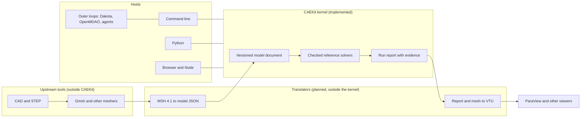

# Simulation landscape

This page places CAEKit among existing simulation infrastructures. For each external system it records the
licence, what CAEKit can learn from it and how far that learning may go. It is the one home in the repository
for facts about other systems, for the lessons taken from them, and for the licence class of each system. The
licence rule itself is in [AGENTS.md](../../AGENTS.md#code) and [SPEC-EXT-008](spec.md#spec-ext-008); this page
classifies systems against that rule and does not add to it.

- What CAEKit guarantees, and will guarantee, is defined in [spec.md](spec.md).
- How CAEKit is built and in which order the planned features arrive is in [blueprint.md](blueprint.md).
- The present crates, model documents, physics kinds and rules are in [ARCHITECTURE.md](../ARCHITECTURE.md),
  [model.md](../model.md), [docs/physics/](../physics/), [provenance.md](../provenance.md) and
  [AGENTS.md](../../AGENTS.md). This page links to them and does not restate them.

## How to use this page

- **Before proposing a feature**, look up the lesson IDs in [Lessons](#lessons). An `AVOID` entry records a
  pattern that conflicts with a rule in [AGENTS.md](../../AGENTS.md) or with a requirement or non-goal in
  [spec.md](spec.md); the entry names which. Propose it again only with an argument against that rule.
- **Before reading, citing or porting the code of another project**, look up its class in
  [Licence boundaries](#licence-boundaries).
- **Before claiming that CAEKit is unusual in some respect**, check [Where the field leaves room](#where-the-field-leaves-room).
  Every absence claim there is limited to the sources in [References](#references).
- **When an external fact changes**, such as a version, a licence or a behaviour, update it here, in the entry
  of that system, and nowhere else.
- **When a status changes**, update the CAEKit column here together with the requirement in [spec.md](spec.md)
  that the cell cites.

## Contents

- [Status and evidence legend](#status-and-evidence-legend)
- [Positioning](#positioning)
- [Open finite element frameworks](#open-finite-element-frameworks)
- [CFD, multibody and multiphysics](#cfd-multibody-and-multiphysics)
- [Coupling and co-simulation standards](#coupling-and-co-simulation-standards)
- [Commercial baseline](#commercial-baseline)
- [Numerical kernels](#numerical-kernels)
- [Rust and WebAssembly ecosystem](#rust-and-webassembly-ecosystem)
- [Verification and interoperability](#verification-and-interoperability)
- [Recurring industry patterns](#recurring-industry-patterns)
- [Where the field leaves room](#where-the-field-leaves-room)
- [Features worth combining](#features-worth-combining)
- [Lessons](#lessons): [adopt](#adopt), [adapt](#adapt), [avoid](#avoid)
- [Licence boundaries](#licence-boundaries)
- [Open questions](#open-questions)
- [References](#references)

## Status and evidence legend

**CAEKit status.** Each claim about CAEKit carries one of these words.

| Word | Meaning |
| --- | --- |
| Implemented | Present in the repository at the path given. |
| Partial | Present for some kinds or in a weaker form; the cell names the missing part. |
| Planned | Specified in [spec.md](spec.md) or sequenced in [blueprint.md](blueprint.md), which the cell cites. Not in the repository. |
| Deferred | Neither planned nor excluded; the cell states the condition for revisiting it. |
| Not planned | Deliberately excluded; the reason is in [Avoid](#avoid) or in the [spec.md non-goals](spec.md#non-goals). |

A requirement is cited by its identifier, for example [SPEC-DET-003](spec.md#spec-det-003); a non-goal by its
`NG-NN` identifier in the [non-goals table](spec.md#non-goals); a design decision by its `D-NN` identifier in
[blueprint.md § 16](blueprint.md#16-design-decisions).

**External evidence.** Facts about other systems come from the primary source cited in [References](#references),
as read on the access dates given there. Versions and licences will drift. **UNVERIFIED** marks a statement that no
primary source confirmed. For commercial products, `E` marks a statement seen only as a search excerpt of the
vendor page.

**Version read.** In the version columns, the date in parentheses is the release date of that version. `page dated`
marks the date printed on the page that names the version, and `tag` a repository tag without a release object. A
version without a date was read where no date was given.

**Prior-art class.** Each external system has one class. The class decides what CAEKit may take from it.
[Licence boundaries](#licence-boundaries) gives the rules for each class.

| Class | Meaning |
| --- | --- |
| **D** | Dependency candidate: permissive and pure Rust, and meets the dependency rules of [AGENTS.md](../../AGENTS.md#code) as far as read on the date given; the `wasm32-unknown-unknown` column of each table states whether that target was built or only documented. |
| **P** | Permissive source: ideas and methods; code under the conditions of [Rules per class](#rules-per-class), which separate Apache-2.0-only sources. |
| **S** | Study only: copyleft, mixed or unclear terms. Behaviour, documentation, source and published methods may be studied and cited. Code is never copied or ported. |
| **C** | Commercial product: only publicly documented behaviour may be studied. No code, no manual text. |
| **N** | Standard or specification: implemented from the published text when its terms allow; cited, not reproduced, when paywalled or copyrighted. |

## Positioning

CAEKit is a small, permissively licensed reference kernel. It accepts one strict, versioned JSON document. It
solves only physics kinds that have an independently derived analytical reference. It returns a report that
carries its own evidence: model identity, convergence thresholds with true residuals, and signed conservation
balances. The same Rust code runs natively, from Python and in WebAssembly, and the builds are compared against
each other. CAEKit does not compete with general-purpose frameworks on breadth, scale or performance. It competes
on whether a third party can recompute, rerun and check a result.

### What exists today

| Property | Status | Where |
| --- | --- | --- |
| One strict document per model; unknown versions, fields, kinds and conditions rejected | Implemented | `deny_unknown_fields` across `crates/caekit/src/model.rs` and the domain crates; [model.md](../model.md) |
| Content identity `model_sha256` over the serialized typed model with defaults applied | Implemented | `crates/caekit/src/lib.rs`; frozen digests in `crates/caekit/tests/model_identity.rs` |
| Steady or static, linear physics kinds, each with an analytical reference | Implemented | [docs/physics/](../physics/), `examples/`, `crates/caekit/tests/` |
| Jacobi-preconditioned conjugate gradient, accepted only on a recomputed true residual, with a closed set of stop reasons | Implemented | `crates/caekit-numerics/src/lib.rs`; [model.md](../model.md#numerical-stages) |
| Fields and balances withheld when a stage does not converge; traces kept | Implemented | Early return in each solver, for example `crates/caekit-thermal/src/heat_conduction.rs`; run stop reason in `crates/caekit/src/lib.rs`; [model.md](../model.md#numerical-stages) |
| Signed per-term balances with a signed imbalance | Implemented | `Balance` in `crates/caekit-types/src/quantity.rs` |
| In-process partitioned Gauss–Seidel coupling with conservative overlap transfer, without relaxation or acceleration | Implemented | `crates/caekit-thermal/src/lib.rs`; [cooling-channel.md](../physics/cooling-channel.md) |
| Native against WASI comparison of every reference model at relative 1e-10, with unit floors near zero | Implemented | `scripts/verify-reference-cases.mjs` |
| Command-line `check` and `run`; Python and WebAssembly packages without physics | Implemented | `crates/caekit-cli/src/main.rs`; [python.md](../python.md); [wasm.md](../wasm.md) |
| Permissive-only licence policy for the locked dependency graph | Implemented | `deny.toml`; [provenance.md](../provenance.md) |
| Refinement study with measured order for `elastic_solid` | Partial: patch and load-case tests only; no refinement study | `crates/caekit/tests/elastic_solid.rs`; [SPEC-VER-002](spec.md#spec-ver-002) |
| Only IEEE-exact operations on result and decision paths, as defined in [SPEC-DET-003](spec.md#spec-det-003) | Partial: the sites that still use `f64::hypot`, `powi` or `powf` are listed in [SPEC-DET-003](spec.md#spec-det-003); no `clippy.toml` enforces the rule ([SPEC-DET-004](spec.md#spec-det-004), Planned) | [Floating-point determinism](#floating-point-determinism); [blueprint.md § 12.3](blueprint.md#123-known-sites) |
| Generated JSON Schema of the model document | Planned | [SPEC-AIA-001](spec.md#spec-aia-001) |
| Stable error codes beside the JSON path | Planned | [SPEC-AIA-002](spec.md#spec-aia-002) |
| Mesh import (Gmsh MSH 4.1) | Planned | [SPEC-OUT-006](spec.md#spec-out-006) |
| Field export (VTU) | Planned | [SPEC-OUT-007](spec.md#spec-out-007) |
| Higher-order elements (P2 tetrahedra) | Planned | [SPEC-DIS-005](spec.md#spec-dis-005) |
| Sparse direct solvers | Planned | [SPEC-SOL-006](spec.md#spec-sol-006) |
| Nonlinear solvers | Planned | [SPEC-SOL-011](spec.md#spec-sol-011), [SPEC-PHY-016](spec.md#spec-phy-016) |
| Eigensolvers | Planned | [SPEC-SOL-014](spec.md#spec-sol-014), [SPEC-PHY-008](spec.md#spec-phy-008) |
| Transient solvers | Planned | [SPEC-SOL-013](spec.md#spec-sol-013), [SPEC-PHY-007](spec.md#spec-phy-007) |
| Explicit dynamics, topology optimisation, turbulence kinds, GPU solving | Not planned | [spec.md non-goals](spec.md#non-goals) NG-13, NG-14, NG-16, NG-18 |

### Where CAEKit sits



Against the categories below, CAEKit is:

- **narrower than every open framework** in elements, analysis types and scale, and
  **stricter than all of them** in its input contract and its report;
- **an embeddable evaluator** for coupling and outer-loop tools, not a coupling library or an optimizer;
- **behind the commercial baseline in analysis breadth**, not in rigour: it lacks modal, buckling, frequency,
  transient and nonlinear analysis, and its reporting contract is already stricter than the documented behaviour
  of the vendors;
- **a consumer of numerical-kernel ideas** that keeps an in-house, serial, deterministic solver stack;
- **one of the few pure-Rust, WebAssembly-ready simulation kernels**, and the only one found that ties its claims
  to analytical references and a cross-target comparison.

## Open finite element frameworks

### Comparison

| System | Core and user surface | How a model is stated | Solver backends | Licence | Version read | Class |
| --- | --- | --- | --- | --- | --- | --- |
| DOLFINx (FEniCSx) | C++, Python | UFL weak forms, compiled to C just in time by FFCx | PETSc, optional (pip wheels lack it) | LGPL-3.0-or-later; Basix MIT; UFL LGPL-3.0-or-later | 0.11.0 (2026-06-09) | S (Basix P) |
| deal.II | C++ library | C++ program with hand-written assembly loops | Own Krylov; PETSc and Trilinos interfaces | Apache-2.0 WITH LLVM-exception, or LGPL-2.1-or-later (dual) | 9.8.0 (2026-08-09) | P under the Apache option |
| MFEM | C++ library | C++ program; forms and integrators, full or partial assembly | Own PCG/MINRES/GMRES; SuiteSparse, hypre, PETSc, SUNDIALS, libCEED | BSD-3-Clause | 4.10 (2026-09-01) | P |
| Firedrake | Python, generated C | UFL weak forms; PETSc options for solvers | PETSc | LGPL-3.0-or-later; PyOP2 BSD-style | 2026.10.0 (2026-10-02) | S |
| DUNE | C++ templates, Python bindings | C++ program on a generic grid interface | dune-istl and others | GPL-2.0 with a runtime exception | 2.11.0 (2026-02-02) | S |
| libMesh | C++ library | C++ program; mesh, DOF and adaptive refinement | PETSc and others | LGPL-2.1 | 1.8.4 and 1.9.0-rc2 (2025-10-06) | S |
| MOOSE | C++ on libMesh | HIT hierarchical text input | PETSc | LGPL-2.1 | 2026-09-25 release | S |
| Kratos Multiphysics | C++ core, Python | `ProjectParameters.json` plus materials JSON and mesh | Own, Trilinos, AMGCL | BSD-style with an advertising clause | 10.4.4 (2026-10-06) | S |
| GetFEM | C++ with Python, Octave, Scilab, Matlab | Generic Weak Form Language with symbolic tangents | UNVERIFIED | LGPL-3.0-or-later with GCC Runtime Library Exception 3.1 | 5.5 (June 2026) | S |
| FreeFEM | C++ interpreter | `.edp` scripts in its own language | UMFPACK, MUMPS, SuperLU_DIST, hypre, PETSc and others | LGPL-3.0-or-later | 4.17 (2026-07-13) | S |
| scikit-fem | Pure Python | Decorated Python forms assembled into SciPy matrices | SciPy | BSD-3-Clause | 12.0.2 (2026-06-05) | P |
| SfePy | Python with some C | Problem description files (Python modules) built from named terms | SciPy and others | New BSD | 2026.3 (2026-09-29) | P |
| code_aster | Fortran, C, C++, Python | Python command files; MED meshes | Own, MUMPS, PETSc (UNVERIFIED) | GPL-3.0-or-later | 18.1.11 and 17.5.8 (tag, 2026-10-16) | S |
| CalculiX | C, Fortran | Abaqus-style `.inp` keyword decks | SPOOLES, PARDISO (UNVERIFIED) | GPL-2.0-or-later | 2.23 (page dated 2025-11-01) | S |
| Elmer FEM | Fortran 90, GUI | `.sif` keyword files | Own, hypre, UMFPACK, ARPACK | Solver library LGPL, most modules and GUI GPL; exact versions inconsistent in the sources (UNVERIFIED) | 26.2.1 (2026-04-29) | S |

The frameworks fall into two traditions. Weak-form or script frameworks (DOLFINx, Firedrake, FreeFEM, GetFEM,
SfePy, scikit-fem, code_aster) put the model in executable code. Document or keyword frameworks (Kratos, MOOSE,
Elmer, CalculiX) separate the model from the code. CAEKit belongs to the second tradition and has the strictest
schema of the group. Among the fifteen, only MFEM, scikit-fem, SfePy and deal.II (under its Apache option) are
permissive without an advertising clause, and only scikit-fem has no compiled code of its own (it depends on NumPy and SciPy).

### Entries

| System | Relevance to CAEKit | Lessons |
| --- | --- | --- |
| DOLFINx | Its unit tests reproduce polynomials that lie in the discrete space and set the tolerance from the epsilon of the scalar type. Its just-in-time compilation and code-as-model input are the opposite of an embeddable, digestible document. No browser build was found. | ADOPT-01, ADAPT-14, AVOID-01 |
| deal.II | Stores expected output next to each test and compares it with a floating-point-tolerant `numdiff`. Publishes a journal paper per release. | ADOPT-03, ADAPT-16 |
| MFEM | Calls itself a "finite element to linear algebra translator": assembled or matrix-free operators are first-class objects. It is the most permissive large reference for element and quadrature algorithms. | ADAPT-01, ADAPT-11 |
| Firedrake | Regression tests assert observed convergence orders, and representable solutions to `1e-9`. Zenodo snapshots archive each release. | ADOPT-01, ADAPT-16, AVOID-02 |
| DUNE | A narrow, stable grid interface separates grids from discretizations. Its licence shows why LGPL is awkward for template code, and the same holds for Rust generics. | ADAPT-14 |
| libMesh | Its `master` branch advances only on commits that pass extended testing. Its `opt` build does "little to no error checking". | ADOPT-04, AVOID-09 |
| MOOSE | The most formalised verification practice found: TestHarness with `Exodiff`, `CSVDiff`, `JSONDiff` and MMS testers; unused input parameters are errors in tests; ASME NQA-1 traceability from requirement to test to document; a canonical formatter for its input language. | ADOPT-03, ADOPT-04, ADOPT-15, AVOID-10 |
| Kratos | The closest input model to CAEKit. `ValidateAndAssignDefaults` rejects unknown keys and fills defaults, but each component opts in. Its BSD licence carries an advertising clause. | ADAPT-02, AVOID-02 |
| GetFEM | Separates geometry, element, quadrature and weak-form term internally, and derives tangents symbolically from the weak form. | ADAPT-14, AVOID-01 |
| FreeFEM | A productive weak-form language whose scripts cannot be digested, validated by a schema or compared as data. An older JavaScript port exists; its status is UNVERIFIED. | AVOID-01 |
| scikit-fem | The only framework found with a maintained browser path (Pyodide demo). Tests fit the convergence rate by least squares over several levels with a two-sided bound. | ADOPT-02, ADAPT-19 |
| SfePy | The mesh is a separate file, and equations are built from a documented catalogue of named terms. | ADAPT-05, ADAPT-07 |
| code_aster | Publishes a catalogue of about 4,600 verification cases and separates public tests from tests on proprietary data. | ADOPT-05 |
| CalculiX | Grew by accepting Abaqus-style input that commercial pre-processors already write. | ADAPT-04, AVOID-15 |
| Elmer FEM | Tests declare a `Reference Norm`, and its own test file states that this implies "consistency, not correctness". | ADOPT-03 |

## CFD, multibody and multiphysics

### Comparison

| System | Role | How a case is stated | Convergence declaration | Licence | Version read | Class |
| --- | --- | --- | --- | --- | --- | --- |
| OpenFOAM (OpenCFD line) | Finite-volume CFD | Directory of dictionaries: `constant/`, `system/`, `0/` | `tolerance` or `relTol` per solve; `residualControl` on initial residuals | GPL | v2606 (2026-06-26) | S |
| OpenFOAM (Foundation line) | Finite-volume CFD | As above | As above | GPL-3.0-or-later | 14 (2026-07-14) | S |
| SU2 | Finite-volume CFD and adjoint design | Flat `key = value` file; sub-files per zone inherit options | `CONV_FIELD`, `CONV_RESIDUAL_MINVAL`, Cauchy window | LGPL-2.1, with bundled METIS and TecIO terms | 8.6.0 (2026-10-30) | S |
| Nektar++ | Spectral/hp elements | XML session file | Per solver section | MIT | 5.10.0 (2026-07-04) | P |
| Project Chrono | Multibody and multiphysics dynamics | C++, JSON hierarchies, YAML since 10.0.0 | Integrator tolerances; assembly status | BSD-3-Clause | 10.0.0 (2026-03-27) | P |
| MBDyn | Multibody initial-value solver | Block-structured text file | `norm` or `minmax` residual, optional increment test | GPL (2.0-or-later on the forge; "GPL 2.1" on the site) | 1.7.3 (date UNVERIFIED) | S |

### Entries

| System | Relevance to CAEKit | Lessons |
| --- | --- | --- |
| OpenFOAM | Reports continuity error three ways: local (absolute, non-cancelling), global (signed) and cumulative. Its normalised residual depends on the initial field, so the convergence history depends on the starting point. A case spans many files. | ADOPT-08, AVOID-03, AVOID-07 |
| SU2 | Publishes a scripted manufactured-solution study for compressible Navier–Stokes with L2 and L∞ errors and observed orders. Its regression harness keeps separate expected values for aarch64, and silently ignores volume outputs that do not apply. | ADOPT-02, ADAPT-03, AVOID-04 |
| Nektar++ | Keeps geometry, expansion order and conditions as separate sections of one document, and offers an `Error` filter that reports an error norm against a supplied solution. Its `Expressions` section is a small expression language. | ADAPT-12, AVOID-01 |
| Chrono | Couples subsystems through two calls, `Synchronize` then `Advance`. Its changelog fixes non-reproducible FSI loads by summing in a fixed order. `DoAssembly()` can return positions and velocities together with an "inaccurate" status. | ADAPT-06, ADOPT-11, AVOID-05 |
| MBDyn | Records per step which test, residual or increment, decided convergence, and can stop at a named phase (`abort after`). Its `max iterations: N, at most` counts a step as successful without passing the test. | ADOPT-07, AVOID-05 |

## Coupling and co-simulation standards

### Comparison

| System | Coupling model | Stabilisation | Non-convergence behaviour | Licence | Version read | Class |
| --- | --- | --- | --- | --- | --- | --- |
| preCICE | Partitioned peers over MPI or TCP; XML configuration | Constant, Aitken, IQN-ILS (Anderson), IQN-IMVJ | Advances after `max-iterations` by default; only a `strict` measure ends the run | LGPL-3.0 | 3.5.0 (2026-11-11) | S |
| FMI 3.0 | Importer-driven master algorithm over FMUs | Importer's choice, with state save and restore | Status codes `OK`, `Warning`, `Discard`, `Error`, `Fatal`, each with a stated output guarantee | Specification CC BY-SA 4.0; headers and schemas BSD-2-Clause | 3.0.2 (2024-11-27) | N |
| SSP | System structure of component models | Not applicable | Not applicable | Schemas BSD-2-Clause; documents CC BY-SA 4.0 | 2.0.1 (2026-05-05) | N |
| Modelica language | Acausal connection equations | Compiler-selected | Not read | Association copyright, free distribution with notice | 3.7 (2026-05-19) | N |
| Modelica Standard Library | Component library | Not applicable | Not applicable | BSD-3-Clause | 4.1.0 (2025-05-23) | P |
| OpenModelica | Compiler and FMI/SSP environment | Compiler-selected | Not read | OSMC-PL 1.8 with an AGPL-3.0 mode | 1.27.2 | S |
| OpenMDAO | Hierarchical MDAO in Python | Block Gauss–Seidel with Aitken, Newton, Broyden | Continues unless `err_on_non_converge` is set | Apache-2.0 | 3.45.2 (2026-10-27) | P |
| Dakota | Optimisation and UQ around an external evaluator | Method-defined | Results file beginning with `fail`; `failure_capture` policy | LGPL-2.1 | 7.0.0 (2026-11-17) | S |
| **CAEKit** | In-process partitioned Gauss–Seidel in `cooling_channel`; one-way in `thermoelastic_solid` | None (Implemented, `crates/caekit-thermal/src/lib.rs`) | First non-converged stage stops the run; fields and balances withheld (Implemented) | MIT OR Apache-2.0 | pre-release | — |

### Co-simulation contracts

| Contract element | preCICE | FMI 3.0 | Chrono | Dakota | CAEKit |
| --- | --- | --- | --- | --- | --- |
| Unit of exchange | Mesh data per time window | Typed scalar or array variables | Force and displacement | Parameter and response sets | Named quantity with unit, location and signed meaning (Implemented in reports) |
| Static description | XML configuration | `modelDescription.xml` | JSON hierarchy | Input file or JSON | Versioned model document (Implemented); capability record (Planned, [SPEC-EVD-005](spec.md#spec-evd-005)) |
| Identity | Configuration checked against a reference | Opaque `instantiationToken` | None read | Cache by binary equality | `model_sha256`, recomputable by anyone (Implemented) |
| Step primitive | `advance` with checkpoints | `fmi3DoStep` | `Synchronize`, then `Advance` | One process per evaluation | Exchange, then solve, inside a coupler (Planned, [SPEC-EXT-006](spec.md#spec-ext-006)) |
| Failure signal | `strict` measure, log flag | Five status codes | Assembly status | `fail` in the results file | Closed stop reasons and exit codes ([model.md](../model.md#numerical-stages); Implemented) |
| Capability discovery | Not read | Capability flags as data | Not read | Not applicable | Capability record (Planned, [SPEC-AIA-005](spec.md#spec-aia-005)) |

### Entries

| System | Relevance to CAEKit | Lessons |
| --- | --- | --- |
| preCICE | The reference vocabulary for interface transfer: `consistent` for intensive and `conservative` for extensive quantities, where conservative preserves the global sum. Its documentation says that implicit coupling should always use acceleration, because otherwise it "has no benefit over an explicit coupling", and that the inner convergence measure should be about two orders of magnitude stricter than the coupling criterion to get good quasi-Newton performance. System tests compare exports at a default relative tolerance of 3e-7 and iteration logs by SHA-256. The preCICE v2 paper reports use by more than 100 research groups (as of 2022). | ADOPT-09, ADAPT-06, AVOID-05, AVOID-20 |
| FMI and SSP | Capability flags and status codes published as data, each status with a stated guarantee about which outputs are defined. Units are exponents of the seven SI base units plus `rad`. 250 tools are listed as supporting FMI. Reference FMUs (BSD-2-Clause) serve as test models. | ADOPT-07, ADAPT-07, ADAPT-08 |
| Modelica | A connection set makes potential variables equal and flow variables sum to zero, with sign `+1` for inside and `−1` for outside connectors. Every non-partial model must be locally balanced, checked statically before simulation. Stream connectors define convected quantities by flow direction (`inStream`, `actualStream`). | ADOPT-10, ADAPT-13, AVOID-01 |
| OpenMDAO | `NonlinearBlockGS` offers Aitken relaxation and stall detection (`stall_limit`, `stall_tol`). `check_partials` compares analytic derivatives with finite differences or complex step. Connecting a unitless variable to one with units only warns. | ADOPT-09, ADAPT-15, AVOID-19 |
| Dakota | Drives a simulation through parameter and results files. Version 7.0 made Pydantic models the authoritative grammar and added JSON input. Its evaluation cache uses binary equality and can miss across machines; a stochastic method without `seed` is not repeatable. | ADOPT-16, ADOPT-17, AVOID-10 |

## Commercial baseline

### Capability matrix

`●` means confirmed in the cited sources. A blank means not confirmed, not absent. Columns: ANS Ansys Mechanical,
FLU Ansys Fluent, ABQ Abaqus, CMS COMSOL Multiphysics, NAS MSC Nastran, OPT Altair OptiStruct, DYN LS-DYNA, SCC
Simcenter STAR-CCM+, SIM SimScale. The CAEKit column is the repository today.

| Capability | ANS | FLU | ABQ | CMS | NAS | OPT | DYN | SCC | SIM | CAEKit |
| --- | --- | --- | --- | --- | --- | --- | --- | --- | --- | --- |
| Linear static | ● | | ● | ● | ● | ● | | ● | ● | Implemented: `axial_bar`, `elastic_solid` |
| Normal modes | ● | | ● | ● | ● | ● | | | ● | Planned: [SPEC-PHY-008](spec.md#spec-phy-008) |
| Linear buckling | ● | | ● | | ● | ● | | | | Planned: [SPEC-PHY-009](spec.md#spec-phy-009) |
| Frequency response | ● | | ● | ● | ● | ● | | | ● | Planned: version 2 `analysis` section ([blueprint.md § 13.4](blueprint.md#134-analysis-types)) |
| Implicit or modal transient | ● | | ● | ● | ● | ● | | | ● | Planned: [SPEC-PHY-007](spec.md#spec-phy-007), [SPEC-PHY-015](spec.md#spec-phy-015) |
| Explicit dynamics | | | ● | | ● | ● | ● | | | Not planned: AVOID-21, NG-13 |
| Nonlinear static | ● | | ● | ● | ● | ● | | | | Planned: [SPEC-PHY-016](spec.md#spec-phy-016) |
| Steady heat transfer | | ● | | | ● | ● | | ● | ● | Implemented: `heat_conduction`, `multimaterial_heat_conduction` |
| Coupled thermal-stress | | | ● | | | ● | | | ● | Partial: one-way steady `thermoelastic_solid` |
| Incompressible CFD | | ● | | | | | | ● | ● | Partial: fully developed `laminar_channel` only |
| Design optimisation | | | | | ● | ● | | ● | | Not planned in the kernel: hosts drive it as an outer loop ([SPEC-DOC-013](spec.md#spec-doc-013), NG-16) |
| Ordered steps or study chains | | | ● | ● | ● | ● | | ● | | Planned: version 2 `analysis` section ([blueprint.md § 13.4](blueprint.md#134-analysis-types)) |
| Check-only run | | | ● | | ● | ● | | | ● | Implemented: `caekit check` in `crates/caekit-cli/src/main.rs` |
| Singularity and mechanism diagnostics | | | | | ● | | | | | Partial: a mechanism ends as `numerical_breakdown` ([SPEC-DIS-008](spec.md#spec-dis-008)); a diagnostic cause is planned ([SPEC-CNV-007](spec.md#spec-cnv-007)) |
| Named convergence criteria reported | | ● | ● | ● | ● | | | | ● | Implemented: `Convergence` per stage in `crates/caekit-numerics/src/lib.rs` |
| Balance or resultant report | | ● | | | ● | | ● | | | Implemented: `Balance` in `crates/caekit-types/src/quantity.rs` |
| Published verification cases | ● | | ● | ● | | ● | | ● | ● | Partial: physics pages and tests; no catalogue with stable IDs, target, computed value and ratio ([SPEC-VER-007](spec.md#spec-ver-007)) |
| Scripting or programmatic API | ● | ● | ● | ● | ● | | | ● | ● | Implemented: `crates/caekit`, `crates/caekit-py`, `crates/caekit-wasm` |
| Documented reproducibility limits | ● | | ● | | | | ● | | | Implemented as a contract: native against WASI in `scripts/verify-reference-cases.mjs` |

### Entries

All products are proprietary and class **C**. Their Python clients PyMAPDL, PyMechanical and PyFluent and the
SimScale SDK are MIT-licensed but need a licensed back end or the hosted service.

| Product | Relevance to CAEKit | Lessons |
| --- | --- | --- |
| Ansys Mechanical | Verification Manual cases state a cited reference, a target, the computed value and their ratio (VM1: targets 900.0 lb and 600.0 lb, ratio 1.000) `E`. The manual notes that different computers and operating systems may give slightly different results `E`. | ADOPT-05 |
| Ansys Fluent | Reports scaled and unscaled residuals separately; the globally scaled density-based residual is normalised by the largest residual of the first five iterations `E`. Flux reports cover mass and heat through boundaries. | ADOPT-08, AVOID-07 |
| Abaqus | Separates general steps, which carry state, from linear perturbation steps (buckling, frequency, modal dynamics) about a base state. Pairs a residual check (`R_n = 0.005`) with a correction check (`C_n = 1e-2`) and relaxes the residual tolerance to `R_p = 2e-2` after `I_P = 9` iterations. Linear solver tolerances are independent of Newton tolerances. Results can differ with processor count. | ADOPT-13, ADOPT-14, AVOID-06 |
| COMSOL | Calls its adaptive estimate an "error indicator" because it contains an unknown constant `E`. Publishes 203 verification and validation models, including ASME, NAFEMS and TEAM benchmarks, tested against the latest version. | ADOPT-18, ADOPT-05 |
| MSC Nastran | The model checkout set: `GROUNDCHECK` (rigid motion exposes unintended constraints), `WEIGHTCHECK`, load and reaction resultants (`PRTRESLT`), `MAXRATIO` (default `1.E7`) for near-singular factors, and `PARAM,CHECKOUT,YES` for a check-only run. It can also constrain singularities silently (`AUTOSPC`) and continue past them (`BAILOUT`). Solution sequences are declared step lists. | ADOPT-12, AVOID-06, AVOID-15 |
| Altair OptiStruct | Publishes coarse-mesh results honestly. For NAFEMS LE5 the target is −108 MPa (compressive), Quad4 gives −112.2 MPa and Quad8 −110.9 MPa; derived as computed ÷ target − 1, the errors are 3.9 % and 2.7 %. | ADOPT-05 |
| LS-DYNA | Reports global (`glstat`) and per-part (`matsum`) energy with named terms; total energy should equal initial energy plus external work `E`. Summation order varies between runs unless a consistency option fixes it; core count and SMP against MPP change results `E`. | ADOPT-11, AVOID-21 |
| STAR-CCM+ | A suite of more than 30,000 stored-baseline cases, with a 77-case subset shipped for customers to verify an installation (2016 report). Declarative simulation operations replaced Java macros in cited cases. | ADOPT-19, AVOID-10 |
| SimScale | Hosted platform over OpenFOAM and code_aster. Its NAFEMS thick-plate case reports seven mesh variants, from about −29 % on a coarse extruded mesh to within about 0.7 % on second-order tetrahedra `E`. The SDK uses typed setup objects. | ADOPT-16, AVOID-10 |

The commercial products show that the gap is analysis breadth: element order, modes, steps, transient and
nonlinear analysis. They do not show a higher bar for evidence. Each of Ansys, Abaqus and LS-DYNA documents
platform or parallel variation that CAEKit's cross-target contract excludes.

## Numerical kernels

### Comparison

| System | Role | Convergence contract | Determinism behaviour | Licence | Version read | Class | Lessons |
| --- | --- | --- | --- | --- | --- | --- | --- |
| PETSc | Linear, nonlinear and time solvers | `‖r‖₂ < max(rtol·‖b‖₂, atol)`; defaults `rtol = 1e-5`, `atol = 1e-50`, `dtol = 1e5`, `maxits = 1e4`; typed `KSPConvergedReason`; continues after a failed linear solve by default | Depends on configuration | BSD-2-Clause | 3.26.1 | P | ADOPT-07, ADAPT-01, ADAPT-03, AVOID-02, AVOID-05, AVOID-12 |
| Trilinos | Package federation (Belos, MueLu, Amesos2, Ifpack2, Sacado) | Belos converges on the implicit residual, then checks the explicit one and tightens the target if they disagree | Per package | BSD-3-Clause unless a package states otherwise | 17.3.0 (tag) | P | ADOPT-06, ADAPT-01, AVOID-12 |
| hypre | Multigrid preconditioners (BoomerAMG) | Requires a symmetric smoother inside CG | Coarsening seed is `2747 + rank` by default | MIT OR Apache-2.0 | 3.2.1 (2026-11-03) | P | ADOPT-20, AVOID-08 |
| SuiteSparse | Sparse direct kernels and orderings | Per package | Not read | Per package: see [Licence boundaries](#licence-boundaries) | 7.14.1 (2026-09-14) | P for AMD family, S otherwise | — |
| MUMPS | Distributed multifrontal direct solver | Backward error, null-pivot detection, determinant | UNVERIFIED | CeCILL-C with exceptions | 5.9.2 | S | ADOPT-21 |
| SuperLU | Sparse LU | `dgssvx` returns pivot growth, `rcond`, forward and componentwise backward errors | Not read | BSD-style 3-clause; MC64 notice | 7.0.1 (2025-05-08) | P except MC64 | ADOPT-21 |
| Eigen | C++ template algebra | CG reports the recursive residual estimate, without recomputing `b − A x` | OpenMP parallelism; fast math on by default | MPL-2.0, primarily | 5.0.1 (2025-11-11) | S | AVOID-08, AVOID-14 |
| SLEPc | Eigensolvers on PETSc | `EPSComputeError` gives absolute, relative or backward error separately from the estimate; `EPSSetTrueResidual` | Random initial vector by default | BSD-2-Clause | 3.26.1 | P | ADOPT-06, ADOPT-21, AVOID-08 |
| ARPACK (arpack-ng) | Implicitly restarted Arnoldi and Lanczos | Reverse communication | Fixed seed held in saved process state | BSD-3-Clause | 3.9.1 | P | ADAPT-10, AVOID-08, AVOID-13 |
| SUNDIALS | ODE, DAE and nonlinear solvers | KINSOL treats a small step as a stall, not success | Not read | BSD-3-Clause | 7.9.0 | P | ADOPT-07 |
| AMGCL | Header-only AMG | `cg` returns iterations and relative residual estimate, no converged flag; defaults `tol = 1e-8`, `maxiter = 100` | Power-method seed is the OpenMP thread id; default uses a Gershgorin bound | MIT | 1.5.1 | P | ADOPT-20, ADAPT-01, ADAPT-03, AVOID-08, AVOID-14 |
| libCEED | Matrix-free operator kernels | Diagonal assembly without a matrix | Backends labelled "Deterministic Capable" | BSD-2-Clause | 1.1.1 (2026-11-19) | P | ADOPT-20, ADAPT-11 |
| Enzyme | LLVM-level automatic differentiation | Not applicable | Not applicable | Apache-2.0 WITH LLVM-exception | 0.0.311 | P (no kernel use) | — |
| JAX-FEM | Differentiable FEM on JAX | Adjoint by implicit differentiation; JAX `cg` returns `info = None` | 32-bit floats unless `jax_enable_x64` | GPL-3.0 | 0.0.12 | S | AVOID-14 |
| **CAEKit** | Serial Jacobi-PCG from a zero start | `max(atol, rtol·‖b‖₂)`, accepted only after recomputing `b − A x`; stagnation at a binary64 rounding scale; three stop reasons | Serial, ordered, no randomness | MIT OR Apache-2.0 | `crates/caekit-numerics/src/lib.rs` | — | — |

### Diagnostics found in the field

| Diagnostic | Prior art | CAEKit |
| --- | --- | --- |
| True residual of the returned iterate | Belos, PETSc (optional, documented as slow), SLEPc | Implemented: `crates/caekit-numerics/src/lib.rs` |
| Typed breakdown cause | PETSc `KSP_DIVERGED_INDEFINITE_PC`, `_INDEFINITE_MAT`, `_NANORINF`, `_BREAKDOWN` | Partial: one `numerical_breakdown` reason with an optional diagnostic; no machine-readable cause ([SPEC-CNV-008](spec.md#spec-cnv-008)) |
| Normwise backward error `‖r‖ / (‖A‖·‖x‖ + ‖b‖)` | SuperLU `berr`, SLEPc; Rigal and Gaches, via Higham | Planned: [SPEC-CNV-017](spec.md#spec-cnv-017) |
| Condition estimate from CG coefficients | PETSc `-ksp_monitor_singular_value` | Planned: [SPEC-CNV-017](spec.md#spec-cnv-017) |
| Energy-norm error estimate in CG | Arioli | Planned: [SPEC-CNV-017](spec.md#spec-cnv-017) |
| Pivot growth and `rcond` of a direct stage | SuperLU `dgssvx` | Planned: [SPEC-SOL-006](spec.md#spec-sol-006) |
| Operator and adjoint self-tests | PETSc `MatShellTestMult`, `-snes_test_jacobian` | Planned: [SPEC-VER-005](spec.md#spec-ver-005), [SPEC-SOL-012](spec.md#spec-sol-012) |

### Reproducibility as found in kernels

The kernels tie repeatability to process count (hypre), thread id (AMGCL), process state (ARPACK), random start
vectors (SLEPc, SciPy `eigsh` with OS entropy), compiler flags (Eigen), backend (libCEED) or a fixed thread count
and code branch (Intel oneMKL CNR mode). None of those read states a cross-platform bitwise guarantee.
Order-independent summation exists (ReproBLAS, a 6-word accumulator at about 7n additions) but is needed only once
dot products are parallel.

## Rust and WebAssembly ecosystem

### Comparison

| System | Version read | Licence | Minimum Rust version | `wasm32-unknown-unknown`, as documented by the project; not built in this repository unless the cell says so | Class and disposition |
| --- | --- | --- | --- | --- | --- |
| faer | 0.24.4 (2026-06-24) | MIT | 1.84 | Defaults pull `getrandom`; which reduced feature set builds is UNVERIFIED | D: development cross-check only ([blueprint.md D-06](blueprint.md#16-design-decisions), [SPEC-SOL-015](spec.md#spec-sol-015)) |
| nalgebra, nalgebra-sparse | 0.35.0, 0.12.0 | Apache-2.0 only | 1.89 (nalgebra) | Yes, per its documentation | P: not needed for 3×3 and 4×4 algebra; would raise the minimum Rust version |
| sprs | 0.11.6 (2026-10-13) | MIT OR Apache-2.0; `sprs-ldl` 0.10.0 LGPL-2.1 | 1.88 per crates.io | Yes without default features | P: no permissive direct solver; threads by default |
| ndarray | 0.17.2 | MIT OR Apache-2.0 | 1.64 | Not built; `no_std` capable per its documentation | P: no n-dimensional array need |
| russell (lab, sparse, ode, tensor) | 5.5.0 (2026-11-19) | MIT; depends on `algebra_linear` 3.x (BSD-3-Clause AND Apache-2.0) | 1.85, edition 2024 | Not built; its documentation claims both wasm targets with default features | D later: closest prior art; core dependency very young; pulls `structopt` |
| fenris | 0.0.33 (2023-09-25) | MIT OR Apache-2.0 | — | No (`getrandom`, `lzma-sys`) | P: element and quadrature trait design; "not recommended for general usage" |
| diffsol | 0.20.0 (2026-11-13) | MIT | not read | UNVERIFIED | P: ODE and DAE solvers |
| Gmsh and bindings | Gmsh 4.15.2 (2026-03-24); `gmsh_ffi` 0.2.2; `rgmsh` 0.1.2 (2019) | GPL-2.0-or-later with exception; `gmsh_ffi` LGPL-2.1 | — | No (C++ SDK) | S: external producer of mesh files only |
| `mshio`, `vtkio` | 0.4.2 (2020), 0.6.3 (2021) | MIT; MIT OR Apache-2.0 | — | Not probed | P: stale; a small dedicated reader and writer is lower risk |
| truck | modeling 0.6.0 (2024-09-20) | Apache-2.0 | — | Yes | P: topology and geometry split for any future B-rep input |
| Rapier | 0.36.1 (2026-10-10) | Apache-2.0 | 1.86 | Yes with `enhanced-determinism` | P: model for a determinism contract; not a dependency |
| wgpu | 30.0.2 (2026-11-12) | MIT OR Apache-2.0 | 1.87 | Yes (WebGPU) | Not for solving: see below |
| opencascade.js, OCCT | docs v1.1.1 | LGPL-2.1 (OCCT with an exception) | — | Emscripten build | S: CAD belongs upstream of the document |
| PyO3, maturin | 0.30.1, 1.16.0 (latest read; the PyO3 version in use is the one locked in `Cargo.lock`) | MIT OR Apache-2.0 | 1.85 (PyO3 0.30.1); 1.89 (maturin, a build tool whose minimum Rust version does not bind the workspace) | Emscripten for Pyodide | D: used by `crates/caekit-py` |
| wasm-bindgen, js-sys | 0.2.130, 0.3.107 (latest read; the versions in use are the ones locked in `Cargo.lock`) | MIT OR Apache-2.0 | 1.81 (libraries) | Built in this repository by `crates/caekit-wasm` | D: used by `crates/caekit-wasm` |
| libm | 0.2.16 | MIT | not read | Yes | D: candidate for transcendental functions with platform-independent results |

Crates whose minimum Rust version exceeds the workspace `rust-version` (see `Cargo.toml`) would force a raise,
which [AGENTS.md](../../AGENTS.md#code) requires as a change of its own: nalgebra, sprs, wgpu and Rapier in the
table above, and `hdf5-pure` 0.48.0 (1.89) and `rmcp` 3.11.0 (1.88) from
[Verification and interoperability](#verification-and-interoperability), as read from crates.io.

### Browser simulation

- No in-browser FEniCSx was found: the Pyodide 314.0.8 lock file lists 357 packages and none of fenics, dolfin,
  basix, ufl, ffcx, petsc, gmsh, mpi, scikit-fem or felupe; the emscripten-forge channels do not list them either.
- Nearby prior art: OOFEM compiled to a Pyodide module as a demo (licence UNVERIFIED); FElupe in JupyterLite
  (secondary, UNVERIFIED; GPL-3.0-or-later); scikit-fem's Pyodide demo; GLVis-js on MFEM; an old FreeFEM-js.
  None states numerical agreement with its native build.
- PEP 783 defines `pyemscripten` wheels, and several PyO3 packages already ship in Pyodide (pydantic-core, orjson,
  cryptography, polars, rpds-py). Whether maturin 1.16.0 emits the right platform tag is UNVERIFIED.
- Browser GPU compute is unsuited to the solver: WGSL f32 division is accurate to 2.5 ULP, operations may be
  reassociated and flushed to zero, WGSL defines no f64 type, and wgpu's `SHADER_F64` is a native-only Vulkan
  feature.

### Floating-point determinism

| Layer | Guarantee | Exception |
| --- | --- | --- |
| Rust basic operations | `+ − × ÷`, `sqrt`, `mul_add`, casts and comparisons match IEEE 754-2008; `%` matches C `fmod`, which IEEE 754 does not define and whose result is exact (RFC 3514) | x87 targets (i586, 32-bit x86 return values), flush-to-zero 32-bit ARM NEON |
| Rust `f64` methods | `sqrt` and `mul_add` correctly rounded; `floor`, `ceil`, `round`, `trunc` exact | `powi`, `powf`, `exp`, `ln`, `sin`, `cos`, `hypot`, `cbrt`, `atan2` and others: precision "non-deterministic", varying by platform and Rust version |
| Rust NaN | A produced NaN is stable when observed | Sign and payload not deterministic |
| WebAssembly | Round to nearest, ties to even; the Wasm 3.0 deterministic profile fixes NaN results | NaN bits outside that profile, relaxed SIMD, shared-memory threads |
| Wasmtime | Options for NaN canonicalisation and deterministic relaxed SIMD | Defaults |

Consequences for CAEKit, all on the same footing as the Rust documentation:

- The `hypot` folds in `crates/caekit-numerics/src/lib.rs` compute the norm that the stopping test uses.
  `scripts/verify-reference-cases.mjs` requires every stage of both builds to stop as `converged` on the
  reference models, but it does not compare iteration counts or residual histories, so a difference that only
  moves the iteration at which the test passes would not be seen. On a model outside the reference set, a residual
  close to the threshold could still stop as `converged` on one target and `iteration_limit` on another
  ([SPEC-DET-005](spec.md#spec-det-005)).
- `f64::hypot` in `crates/caekit-mesh/src/tetra.rs` computes face areas and normals that enter boundary loads.
- Whether these functions differ between native and WebAssembly builds on CAEKit's reference models is not yet
  measured by any repository test ([Open questions](#open-questions)). The remedy and its test are specified in
  [SPEC-DET-003](spec.md#spec-det-003) and [SPEC-DET-011](spec.md#spec-det-011) and sequenced in
  [blueprint.md § 15](blueprint.md#15-build-sequence).

### Entries

| System | Relevance to CAEKit | Lessons |
| --- | --- | --- |
| faer | The strongest pure-Rust direct and matrix-free algebra: sparse Cholesky, LU and QR with AMD and COLAMD, Krylov-Schur. Its defaults enable `rayon` and `rand`. No reproducibility statement was found. | ADAPT-20, AVOID-08 |
| russell | The only library found with the same edition, a minimum Rust version no higher than the workspace `rust-version` and a documented WebAssembly build of its default features. It requires test coverage above 95 % and compares examples with Mathematica. | ADAPT-21 |
| Rapier | States determinism as conditions: same versions, same insertion order, `enhanced-determinism` with `libm`, SIMD width as its own domain, and IEEE 754 compliance of the platform including WebAssembly. | ADOPT-11 |
| sprs | Its Cholesky requires opting into LGPL (`sprs-ldl`), a trap for a contributor who adds it without reading the licence. | AVOID-16 |
| ndarray | States that only end-user projects should choose a BLAS provider. | ADOPT-11 |
| wasm-bindgen | Moved to a project-specific organisation after the rustwasm organisation was sunset in 2025. The library and the CLI must match exactly. | ADOPT-11 |
| PyO3 | Supports free-threaded CPython since 0.23. The relation between `abi3t` wheels and free-threading is described inconsistently between two of its pages (UNVERIFIED). | ADAPT-19 |

## Verification and interoperability

### Verification and validation standards

| Standard or method | Content relevant to CAEKit | Terms | Class | Lessons |
| --- | --- | --- | --- | --- |
| ASME V&V 10-2019 (R2025) | Vocabulary and framework for VVUQ in computational solid mechanics | Copyrighted, paywalled; not read in full | N | ADOPT-18 |
| ASME V&V 20-2009 (R2021) | Validation as a statement at a validation point; numerical uncertainty as an input to validation | Copyrighted, paywalled; equations UNVERIFIED | N | ADAPT-17 |
| ASME V&V 40-2018 and FDA guidance (2023-11-17) | Rigour scaled to model risk for a stated context of use | ASME copyrighted; FDA guidance public, nonbinding | N | ADAPT-17 |
| NASA-STD-7009B (2024-03-05) | Records for units and frames `[M&S 46]`, domain of verification `[M&S 16]`, warnings `[M&S 32]`; a statement that no uncertainty estimate exists is an accepted report `[M&S 33]` | Public | N | ADOPT-18, ADAPT-17 |
| NAFEMS benchmarks (P18, 1990; R0006, 1993) | Independent targets such as LE10 and LE11; revisions corrected targets, including LE10 twice | Copyrighted; reproduction terms UNVERIFIED | N | AVOID-11 |
| Method of manufactured solutions | Detects any coding error that affects the order of accuracy (Salari and Knupp; Roache; Roy) | Published method | N | ADOPT-02 |
| Richardson extrapolation and GCI | Observed order, extrapolated value and Grid Convergence Index from three grids (Roache; NPARC) | Published method | N | ADAPT-13 |

The relations below are the published ones [NPARC]. `f1` is the finest grid, `r` the constant refinement ratio and
`Fs` the safety factor, `3.0` for two grids and `1.25` for three or more.

```text
p        = ln((f3 - f2) / (f2 - f1)) / ln(r)
f_exact ~= f1 + (f1 - f2) / (r^p - 1)
GCI_12   = Fs * |(f1 - f2) / f1| / (r^p - 1)
GCI_23   = Fs * |(f2 - f3) / f2| / (r^p - 1)
check    : GCI_23 / (r^p * GCI_12) close to 1   (asymptotic range)
```

NPARC publishes a worked example that serves as a conformance vector: `f1 = 0.97050`, `f2 = 0.96854`,
`f3 = 0.96178`, `r = 2`, `Fs = 1.25` give `p = 1.786170`, `f_exact = 0.97130`, `GCI_12 = 0.103083 %`,
`GCI_23 = 0.356249 %` and an asymptotic ratio of `1.002024`. These values are the binary64 evaluation of the
relations above, rounded to the printed digits:

```text
node -e "const f1=0.97050,f2=0.96854,f3=0.96178,r=2,F=1.25,p=Math.log((f3-f2)/(f2-f1))/Math.log(r),q=r**p,a=F*Math.abs((f1-f2)/f1)/(q-1),b=F*Math.abs((f2-f3)/f2)/(q-1);console.log(p,f1+(f1-f2)/(q-1),100*a,100*b,b/(q*a))"
```

It prints `1.78616959…`, `0.97130033…`, `0.10308260…`, `0.35624926…` and `1.00202366…`. NPARC itself prints a ratio
of `1.002019`, computed from the already rounded GCIs, and its program output differs from its hand-worked values
in the fifth and sixth digits (`p = 1.78618479`). A conformance test therefore takes the inputs above, compares with
the recomputed values, and accepts a difference of at most half a unit in the last printed digit, because those
values are exact binary64 results rounded only for print.

### Data formats

| Format | Read | Licence | Needs | Disposition | Lessons |
| --- | --- | --- | --- | --- | --- |
| VTU (VTK XML) | VTK XML format page; cell codes line 3, triangle 5, tetrahedron 10, quadratic tetrahedron 24 | VTK BSD-3-Clause | XML text | First export, written as a small independent writer | ADAPT-04 |
| VTKHDF | Version 2.8, "not considered complete" | BSD-3-Clause | HDF5 | Defer | — |
| XDMF | XDMF3 | Library licence UNVERIFIED | XML plus HDF5 | Avoid the format; keep its split of small metadata from large arrays | — |
| HDF5 | 2.2.0; format specification 4.0 | BSD-3-Clause; `hdf5-pure` 0.48.0 MIT OR Apache-2.0, minimum Rust version 1.89 | C library or pure-Rust reimplementation | Defer; only in a translator behind a feature ([SPEC-OUT-009](spec.md#spec-out-009)) | — |
| CGNS | 4.5.2 | zlib-style | HDF5 | Avoid the format; adapt `DimensionalExponents_t` | ADAPT-18 |
| Exodus II | Exodus 8.24; SEACAS 2026-11-12 | BSD | NetCDF | Later; node and side sets match named regions | — |
| MED | 4.1.0 (Debian) | LGPL-3+ (`med-fichier`); MEDCoupling LGPL-2.1 | HDF5 | Avoid the library | AVOID-16 |
| Gmsh MSH 4.1 | Manual for Gmsh 4.15.2: `$PhysicalNames`, `$Entities`, `$Nodes`, `$Elements`; tags strictly positive and possibly sparse; type 4 is the 4-node tetrahedron | Gmsh GPL-2.0-or-later with exception; the format description may be implemented independently | None | First import, written from the manual | ADAPT-04 |
| STEP AP242 | ISO 10303-242 | Paywalled ISO standard | A geometry kernel | Avoid; CAD stays upstream | AVOID-15 |

### Provenance, contracts and automation

| System | Relevance to CAEKit | Terms | Class | Lessons |
| --- | --- | --- | --- | --- |
| AiiDA | Hash-based caching that prefers false negatives, with `CACHE_VERSION` to invalidate a plugin's results | MIT; 2.9.4 | P | ADOPT-17 |
| Snakemake | `--rerun-triggers` (`code`, `input`, `mtime`, `params`, `software-env`) define what a reproducible run depends on | MIT; 9.27.2 | P | AVOID-10 |
| W3C PROV, Workflow Run RO-Crate | Entity, Activity, Agent and derivation terms; three run-crate profiles implemented in six workflow systems | W3C Recommendations (2013-04-30); public profiles | N | ADAPT-15 |
| JSON Schema 2020-12; `schemars` 1.2.3; `jsonschema` 0.61.2 | Schemas can be generated from Serde types; `schemars` honours `deny_unknown_fields`; support for internally tagged enums is UNVERIFIED | Public specification; crates MIT | N, D | ADOPT-16 |
| RFC 8785 (JCS), RFC 6901, RFC 6902, RFC 7396, RFC 7493 | Canonical JSON; JSON Pointer; JSON Patch and Merge Patch; I-JSON | Public | N | ADOPT-15, AVOID-17 |
| Model Context Protocol, revision 2026-07-28 | Tools declare `inputSchema`; input and business errors return `isError: true` so a model can correct itself; tools SHOULD be listed in a deterministic order; `rmcp` 3.11.0 is Apache-2.0 | Public specification | N | ADAPT-15 |
| Strict structured output of language-model APIs | Both providers require `additionalProperties: false`. Anthropic rejects `oneOf` and recursive schemas, does not support numeric bounds such as `minimum` and `maximum`, and caps the number of optional and union-typed parameters per request. OpenAI requires every field to be listed as required and expresses an optional field as a `null` union | Vendor documentation | C | ADAPT-15 |

### Evidence on programmatic control by software agents

These figures are self-reported by their authors on their own benchmarks and are not comparable with one another.

| Study | Result | Implication for a document-driven kernel |
| --- | --- | --- |
| Shi and Zhang 2026, FoamBench | Execution-feedback repair raised success from 71.8 % to 96.4 %; a single-agent harness scored 96.4 % against 88.2 % for a multi-agent one | Structured errors and runnable examples matter more than orchestration |
| Oza et al. 2026, CFD Forge | A model alone accepted 12 of 13 detectable faults; with deterministic checks deciding, it accepted none | Acceptance must be decided by code, from report evidence |
| Fan et al. 2025, ChatCFD | 82.1 % execution success but 68.12 % physical fidelity on 315 cases | "It ran" overstates "it is right" |
| Yue et al. 2025, Foam-Agent | 88.2 % on 110 basic tasks, 62.5 % on the advanced tier | Difficulty exposes setup errors |
| Mudur et al. 2025, FEABench | Best strategy produced executable API calls 88 % of the time | Large imperative APIs are hard to drive |
| Hamdi et al. 2026 | 96.5 % Pass@3 against 77.1 % Pass³ for one evaluated configuration | Repeatability is a separate metric |
| dos Reis and Dravid 2026 | 30 typed tools check requests against physical bounds; 120 hardware-independent tests pass deterministically | Schema-bound tools work |

## Recurring industry patterns

| Pattern | Seen in | CAEKit today | Implication |
| --- | --- | --- | --- |
| A declarative case document separate from solver code | Kratos, MOOSE, Elmer, CalculiX, OpenFOAM, SU2, Nektar++, MBDyn, preCICE, FMI, Dakota | Implemented: one strict JSON document (`crates/caekit/src/model.rs`) | Keep; publish a generated schema (ADOPT-16) |
| Model as executable code or a weak-form language | DOLFINx, Firedrake, FreeFEM, GetFEM, SfePy, scikit-fem, code_aster, Modelica | Not planned | AVOID-01 |
| A residual threshold plus an iteration cap as the convergence declaration | OpenFOAM, SU2, preCICE, OpenMDAO, MBDyn, PETSc, Abaqus | Implemented, with a recomputed true residual (`crates/caekit-numerics/src/lib.rs`) | Keep the stronger acceptance rule (ADOPT-06) |
| Continuing past non-convergence by default | preCICE, PETSc, OpenMDAO, MBDyn, Chrono | Not planned: the opposite is implemented ([SPEC-CNV-004](spec.md#spec-cnv-004)) | AVOID-05 |
| Golden-output regression with a tolerant numeric diff | deal.II, MOOSE, Elmer, PETSc, SU2, preCICE, Modelica library, STAR-CCM+ | Partial: native against WASI only (`scripts/verify-reference-cases.mjs`); no stored golden reports ([SPEC-VER-008](spec.md#spec-ver-008)) | ADOPT-03 |
| Manufactured or analytical solutions with an observed order | Firedrake, scikit-fem, DOLFINx, MOOSE, SU2 | Partial: required by [AGENTS.md](../../AGENTS.md), missing for `elastic_solid` | ADOPT-01, ADOPT-02 |
| Published verification manuals with targets | Ansys, Abaqus, COMSOL, OptiStruct, STAR-CCM+, SimScale, code_aster | Partial: physics pages; no catalogue with stable IDs ([SPEC-VER-007](spec.md#spec-ver-007)) | ADOPT-05 |
| Defaults merged into the effective configuration | Kratos, MOOSE | Implemented: the digest covers the defaulted model (`crates/caekit/src/lib.rs`) | ADAPT-02 |
| Reproducibility bounded by platform, process count or seed | Ansys, Abaqus, LS-DYNA, SU2, hypre, AMGCL, ARPACK, SLEPc, oneMKL | Implemented as a contract (`scripts/verify-reference-cases.mjs`) | ADOPT-11 |
| Partitioned coupling with fixed-point iteration and acceleration | preCICE, OpenMDAO, SU2, MBDyn, Chrono | Partial: Gauss–Seidel without acceleration | ADOPT-09 |
| External sparse solver backends (PETSc, hypre, MUMPS, SuiteSparse) | MFEM, DOLFINx, Firedrake, libMesh, MOOSE, FreeFEM, Elmer, Kratos | Not planned in the default build ([SPEC-SOL-015](spec.md#spec-sol-015)) | AVOID-12 |
| A Python front end | Nearly every open system | Implemented: `crates/caekit-py` | Keep bindings free of physics |
| Pure-Rust defaults with native accelerators behind opt-in features | russell, nalgebra, ndarray, sprs, faer | Implemented: pure Rust only (`Cargo.toml`, `deny.toml`) | Keep |
| `rayon` or `getrandom` in default features | faer, sprs, fenris | Not applicable | Pin `default-features = false`; AVOID-08 |
| Pre-1.0 crates with routine breaking changes | faer, nalgebra, sprs, ndarray, Rapier, truck, PyO3, wasm-bindgen | Implemented: `Cargo.lock` pins versions | Pin exactly and budget upgrades |
| Interchange through files rather than linking | Gmsh, VTK, fenris, meshio | Planned: translators ([SPEC-OUT-005](spec.md#spec-out-005)) | ADAPT-04 |
| Content hash as the identity of inputs | AiiDA, Snakemake | Implemented: `model_sha256` in `crates/caekit/src/lib.rs` | ADOPT-17 |
| Credibility judged against a stated use | ASME V&V 40, FDA, NASA-STD-7009B | Planned: [SPEC-VER-011](spec.md#spec-ver-011) | ADAPT-17 |

## Where the field leaves room

Each absence claim is limited to the sources in [References](#references). It means "not found there", not
"proven absent".

| Gap | Evidence in the field | CAEKit |
| --- | --- | --- |
| A versioned document whose meaning is frozen, whose identity is a recomputable content digest, and which rejects every unknown field by construction | Kratos validates per component; MOOSE HIT has a formatter; FMI's identity token is opaque | Implemented: `crates/caekit/src/model.rs`, `crates/caekit/tests/model_identity.rs` |
| Fields and balances withheld when a stage does not converge, with the executed traces kept | preCICE, PETSc, OpenMDAO and MBDyn continue by default; Chrono returns state with an "inaccurate" status | Implemented: early return in each solver; run stop reason in `crates/caekit/src/lib.rs` |
| Signed per-term conservation balances as a mandatory part of a structured result | OpenFOAM logs continuity errors; preCICE logs interface integrals; Nastran and LS-DYNA print resultants and energies on request | Implemented: `Balance` in `crates/caekit-types/src/quantity.rs` |
| Cross-platform agreement as a tested contract, including the browser | SU2 keeps per-architecture references; preCICE compares at 3e-7; vendors document variation; browser FEM ports claim no parity | Implemented: `scripts/verify-reference-cases.mjs`; bitwise agreement planned ([SPEC-DET-011](spec.md#spec-det-011)) |
| A permissive, dependency-light kernel that embeds anywhere | Of fifteen open frameworks, four are permissive without an advertising clause, and only scikit-fem has no compiled code of its own; the leading coupling library is LGPL-3.0 and process-based | Implemented: permissive, pure-Rust dependencies by rule (`deny.toml`; [provenance.md](../provenance.md)) |
| A verified, permissively licensed FEM kernel in Pyodide | FEniCSx absent and LGPL; FElupe GPL-3.0; OOFEM a demo | Planned: [SPEC-BND-008](spec.md#spec-bnd-008) (ADAPT-19) |
| Verification evidence shipped as data that travels with the result | Vendors publish manuals and web pages; SU2 publishes scripts | Planned: [SPEC-VER-007](spec.md#spec-ver-007), [SPEC-EVD-005](spec.md#spec-evd-005) |
| A static balance check of a coupled case before solving | Modelica checks balance in the language; document-driven coupling tools do not | Planned: [SPEC-CON-009](spec.md#spec-con-009) |
| A maintained, permissive, WebAssembly-safe Gmsh MSH 4.1 reader that parses from bytes | `mshio` last released 2020; Rust Gmsh bindings stale or LGPL | Planned: [SPEC-OUT-006](spec.md#spec-out-006) |
| A benchmark for agents scored by physical correctness | Agent benchmarks score execution or simulator-specific success | Planned: [SPEC-AIA-009](spec.md#spec-aia-009); the reference models serve |

## Features worth combining

Each feature below exists somewhere. Their value for CAEKit lies in the combination, which no system read here
offers. The combinations are realised in [blueprint.md](blueprint.md).

| Combination | Parts | What each part lacks alone | Together |
| --- | --- | --- | --- |
| Reproducible verified result | Content digest; canonical form; verification catalogue with target, computed and ratio; exact cross-target agreement of iteration counts and stop reasons; numerics revision per kind | A digest says what ran, not whether it is right. A catalogue says the code is right, not for which build. Agreement says builds agree, not with what. | Anyone can recompute the digest, rerun the case natively, from Python or in a browser, obtain the same iterations, stop reason and values, and compare them with an independent target. |
| Safe operation by scripts and agents | Strict schema; generated JSON Schema; error codes with JSON Pointer and valid values; `check` as checkout; acceptance evidence in the report | Strict rejection without structure gives nothing to repair. A schema without a strict kernel accepts what the kernel rejects. Structured output without evidence lets an operator accept a fault. | A generate, check, patch, run and accept-by-code loop, matching the FoamBench and CFD Forge evidence. |
| Trustworthy evaluator for outer loops | Withheld fields; closed statuses with stated guarantees; exit codes; digest plus numerics revision as cache key; determinism | Dakota's binary-equality cache misses across machines; a digest alone would hit across numerics changes (AiiDA's lesson). | Optimisers and UQ drivers get a pure function from document to report, with a typed failure signal and a cache key that is safe in both directions. |
| Conservation by construction and by report | Signed balances; absolute and relative imbalance; declared conservative or consistent transfer; static coupling-graph check; dimension exponents | Modelica checks structure but reports nothing; preCICE declares constraints and logs integrals elsewhere; a signed sum can hide cancellation. | An ill-posed coupling is rejected in `check`; a well-posed one returns signed, scaled, per-interface totals in the same report. |
| From relative agreement to bitwise agreement | IEEE-exact operations only; `libm` for transcendentals; deterministic tie-breaks and start vectors; no threads or SIMD; exact trace comparison; a determinism contract page | Each rule alone leaves another source of divergence. | A claim that native and WebAssembly builds give the same bits on supported targets, which no system read here makes; Rapier states conditions only. |
| A verification record that travels with the result | Analytical references; manufactured solutions; least-squares order; GCI as a pure function; an assessment document by digest with an "uncertainty not characterized" default | Code verification without solution verification says nothing about a user's mesh; an assessment without evidence overclaims. | The same code computes code-verification evidence in CI and solution-verification evidence for a user's mesh family, in every host, without ever claiming validation. |
| A verified permissive kernel in the browser | WebAssembly package; Pyodide wheel; live page; a command that runs the reference cases; cross-target agreement | A browser port without parity is a demo. | A reader can rerun the verification suite in a browser and see the same digests and targets as CI. |
| Adoption without diluting the document | Gmsh import and VTU export as translators; external mesh by content hash; schema; canonical form | Familiar formats as the kernel input would fork the contract. | Users keep their tools, and the strict document stays the only kernel input while the digest still covers the mesh. |
| One numerics investment, many analysis types | Operator, preconditioner and method split; deterministic sparse LDLᵀ with inertia; eigensolver; backward error | Each analysis would otherwise bring its own solver. | Modal analysis with Sturm counts, buckling, limit points, saddle-point systems and an independent cross-check of every PCG result. |
| A verified, reusable coupler | True coupled residual; Aitken, then IQN-ILS with reported relaxation and contraction; stall detection; inner-tolerance rule; exchange-then-solve shape | `cooling_channel` has the residual but no acceleration or shape for reuse. | One loop, tested once against an exact fixed-point reference, serves every partitioned kind with SPD blocks and the existing PCG. |

Combinations that conflict:

| Pair | Conflict | Resolution |
| --- | --- | --- |
| A faer direct backend and a bitwise claim | faer states no cross-target reproducibility and its default features pull `rayon` and `rand`; whether its supernodal and SIMD paths agree bitwise across targets is open ([Open questions](#open-questions)) | Implement the direct solver in-house and use faer only as a development cross-check outside the bitwise claim ([blueprint.md D-06](blueprint.md#16-design-decisions), [SPEC-SOL-015](spec.md#spec-sol-015)) |
| `simd128` builds and the cross-target comparison | SIMD width changes results | Treat SIMD as its own determinism domain; never ship it without rerunning the comparison |
| New report fields for existing kinds and the version 1 freeze | Absolute imbalance, cause codes or backward errors would change existing reports | Only as requested outputs, or under an optional model field that is omitted from serialization when absent, so that the frozen digests in `crates/caekit/tests/model_identity.rs` stay unchanged, or in a new schema version with a migration ([SPEC-DOC-004](spec.md#spec-doc-004), [SPEC-DOC-009](spec.md#spec-doc-009), [blueprint.md § 13.2](blueprint.md#132-opt-in-invariance)) |
| RFC 8785 and the frozen digests | A different canonical form changes every `model_sha256` | Only for new document types or a new schema version (NG-11 in [spec.md](spec.md#non-goals)) |
| Initial-norm scaling and multi-field coupling | `cooling_channel` scales its threshold by the residual at a fixed documented state; across fields this mixes units | Per-field physical scales for new coupled kinds |

## Lessons

Lesson IDs are stable. Cite a lesson by its ID. A lesson is never renumbered; a withdrawn lesson keeps its ID and
states why. Uniqueness and stability of the IDs are kept by review; no script checks them.

### Adopt

Take the practice as it is.

| ID | Lesson | From | CAEKit status |
| --- | --- | --- | --- |
| ADOPT-01 | Two tests per discretization: exact reproduction of a representable solution with a tolerance tied to the precision of the scalar type, and a refinement study on a solution that the discrete space cannot represent | DOLFINx, Firedrake, MOOSE MMS guidance | Partial: all kinds with discretization error except `elastic_solid` (`crates/caekit/tests/`); the missing study is [SPEC-VER-002](spec.md#spec-ver-002) |
| ADOPT-02 | Fit the observed order by least squares over at least three levels and bound it on both sides, so that a super-optimal result also fails; publish the study as a scripted, reproducible artefact | scikit-fem, SU2 | Planned: [SPEC-VER-003](spec.md#spec-ver-003), [SPEC-VER-010](spec.md#spec-ver-010) |
| ADOPT-03 | Golden reports with per-quantity tolerances, each with a stated reason; label regression baselines "consistency" and analytical checks "correctness" | deal.II, MOOSE `JSONDiff`, Elmer, PETSc, preCICE | Partial: native against WASI in `scripts/verify-reference-cases.mjs`; stored golden reports and the consistency and correctness labels are missing ([SPEC-VER-008](spec.md#spec-ver-008)) |
| ADOPT-04 | Requirement, test and document linked by tooling; a release equals a commit that passed the whole comparison | MOOSE NQA-1, libMesh | Partial: `scripts/check-docs.mjs` ties kinds to pages, examples and tests, and a release comes from a verified commit ([SPEC-EVD-010](spec.md#spec-evd-010)); no tooling traces a requirement in [spec.md](spec.md) to its test |
| ADOPT-05 | A public catalogue of verification cases with stable IDs, cited reference, target, computed value and ratio, including honest coarse-mesh errors | code_aster, Ansys VM, Abaqus, COMSOL, OptiStruct | Planned: [SPEC-VER-007](spec.md#spec-ver-007) |
| ADOPT-06 | Iterate on the estimate, accept on the recomputed explicit residual, and state this as a contract | Trilinos Belos, SLEPc | Implemented: `crates/caekit-numerics/src/lib.rs` |
| ADOPT-07 | A closed status vocabulary in which each status states what output is defined; record which criterion decided convergence; a stall is not convergence | FMI 3.0, PETSc, MBDyn, KINSOL | Partial: closed stop reasons and exit codes ([model.md](../model.md#numerical-stages)); the per-status guarantee table is missing ([SPEC-CNV-006](spec.md#spec-cnv-006)) |
| ADOPT-08 | Report a signed net imbalance and an absolute, non-cancelling imbalance side by side; report scaled and unscaled residuals separately | OpenFOAM, Fluent | Partial: signed imbalance only (`crates/caekit-types/src/quantity.rs`); an absolute imbalance and scaled residuals are missing and may enter only under the version 1 freeze rule in [Features worth combining](#features-worth-combining) ([SPEC-CON-005](spec.md#spec-con-005)) |
| ADOPT-09 | Declare each exchanged quantity consistent or conservative and validate that extensive ones use conservative transfer; inner tolerances stricter than the coupling tolerance with the factor stated; Aitken, then IQN-ILS, as named and reported methods; stall detection with a stated limit | preCICE, OpenMDAO | Partial: conservative overlap transfer in `crates/caekit-thermal/src/lib.rs`; declarations, the inner-tolerance factor, acceleration and stall detection are missing ([SPEC-CON-004](spec.md#spec-con-004), [SPEC-CNV-013](spec.md#spec-cnv-013), [SPEC-SOL-010](spec.md#spec-sol-010), [SPEC-CNV-012](spec.md#spec-cnv-012)) |
| ADOPT-10 | Check a coupled case statically before solving: one writer and at least one reader per interface quantity; zero-sum flow terms with a fixed sign rule | Modelica | Planned: [SPEC-CON-009](spec.md#spec-con-009) |
| ADOPT-11 | Fixed summation order as an unconditional rule; a determinism page that lists exact conditions (toolchain, features, insertion order, allowed math functions, SIMD width); libraries never choose threads, BLAS providers or random sources; pin binding tool versions exactly | Chrono, LS-DYNA, Rapier, ndarray, wasm-bindgen | Partial: ordered collections and no threads by rule ([AGENTS.md](../../AGENTS.md#physics-and-numerics)); the determinism contract page is missing ([SPEC-DET-010](spec.md#spec-det-010)) |
| ADOPT-12 | A model checkout set: load and reaction resultants, total mass and centroid, grounding check, conditioning indicator, check-only run | MSC Nastran | Partial: `caekit check` and balances; total mass and centroid, the grounding check and a conditioning indicator are missing ([SPEC-CON-010](spec.md#spec-con-010)) |
| ADOPT-13 | Split general steps from linear perturbation steps when modal and buckling analysis arrive; use the Stationary and Eigenfrequency vocabulary | Abaqus, COMSOL | Planned: version 2 `analysis` section ([blueprint.md § 13.4](blueprint.md#134-analysis-types)) |
| ADOPT-14 | Pair residual and correction checks for Newton iterations, keep linear and nonlinear tolerances separate, and report both | Abaqus | Planned: [SPEC-SOL-011](spec.md#spec-sol-011) |
| ADOPT-15 | A canonical formatter that prints the exact form that is hashed; error locations as RFC 6901 pointers in a new field, keeping the existing `path` text | MOOSE `hit format`, RFC 6901 | Partial: `Error::invalid(path, message)` in `crates/caekit-types/src/error.rs`; the canonical formatter ([SPEC-DOC-008](spec.md#spec-doc-008)) and RFC 6901 pointers ([SPEC-AIA-002](spec.md#spec-aia-002)) are missing |
| ADOPT-16 | Generate the published schema and host-language types from the typed model, as one source of truth; validate examples against it independently; publish a driver recipe for outer-loop tools | Dakota (Pydantic grammar), SimScale SDK, JSON Schema 2020-12 | Planned: [SPEC-AIA-001](spec.md#spec-aia-001), [SPEC-OUT-008](spec.md#spec-out-008) |
| ADOPT-17 | Use the model digest plus an explicit numerics revision per kind as the cache key; prefer cache misses to false hits | AiiDA, Dakota | Partial: `model_sha256` in `crates/caekit/src/lib.rs`; the numerics revision per kind is missing ([SPEC-DET-013](spec.md#spec-det-013)) and enters the report only under the version 1 freeze rule in [Features worth combining](#features-worth-combining) |
| ADOPT-18 | Use V&V vocabulary; call a non-bounding estimate an "error indicator"; default the uncertainty statement to "not characterized"; never claim validation of a user's model | ASME V&V 10, COMSOL, NASA-STD-7009B | Partial: [README.md](../../README.md) states that reference verification does not validate a user's model ([SPEC-VER-012](spec.md#spec-ver-012)); the "error indicator" label and the uncertainty default are missing ([SPEC-DIS-013](spec.md#spec-dis-013), [SPEC-VER-011](spec.md#spec-ver-011)) |
| ADOPT-19 | Ship a user-runnable verification subset that prints target, computed value and ratio, separate from the full regression suite | STAR-CCM+ | Planned: [SPEC-VER-009](spec.md#spec-ver-009) |
| ADOPT-20 | When multigrid preconditions CG, require a symmetric smoother; bound the spectrum with Gershgorin instead of a random power iteration; when a matrix-free operator arrives, require diagonal assembly so Jacobi survives | hypre, AMGCL, libCEED | Planned: [SPEC-SOL-009](spec.md#spec-sol-009) |
| ADOPT-21 | Report backward error, pivot growth and `rcond` for a direct stage, and the recomputed per-pair residual with an absolute test near zero for eigenpairs | SuperLU, MUMPS, SLEPc | Planned: [SPEC-SOL-006](spec.md#spec-sol-006), [SPEC-SOL-014](spec.md#spec-sol-014), [SPEC-CNV-017](spec.md#spec-cnv-017) |

### Adapt

Take the idea and change it to fit the strict document, determinism or the licence rules.

| ID | Lesson | From | Change for CAEKit | CAEKit status |
| --- | --- | --- | --- | --- |
| ADAPT-01 | Separate operator, preconditioner and iteration | PETSc, Belos, AMGCL, faer | Plain Rust traits without interior mutability, so results cannot depend on call order; each method a named, versioned identifier in the report, added only under the version 1 freeze rule in [Features worth combining](#features-worth-combining) | Planned: [SPEC-SOL-003](spec.md#spec-sol-003), [SPEC-SOL-004](spec.md#spec-sol-004); Jacobi is built into the solver today |
| ADAPT-02 | Apply defaults, then show the effective configuration | Kratos | Global, structural strictness; the defaulted model is what `model_sha256` covers and what a canonical form prints | Partial: digest over defaults in `crates/caekit/src/lib.rs`; the canonical form is missing ([SPEC-DOC-008](spec.md#spec-doc-008)) |
| ADAPT-03 | Named, selectable outputs and solver options | SU2, PETSc options, Stratimikos, hypredrive, AMGCL | A closed list in the typed document; unknown or repeated names are errors before solving | Partial: requested outputs and `linear_solver` tolerances; a typed method choice is missing ([SPEC-SOL-004](spec.md#spec-sol-004)) |
| ADAPT-04 | Accept familiar formats | CalculiX, SfePy | Pure byte translators outside the kernel: Gmsh MSH 4.1 in, VTU out, written from the public format descriptions | Planned: [SPEC-OUT-005](spec.md#spec-out-005), [SPEC-OUT-006](spec.md#spec-out-006), [SPEC-OUT-007](spec.md#spec-out-007) |
| ADAPT-05 | Keep the mesh as a separate artefact | SfePy | An optional external mesh referenced by content hash, omitted from serialization when absent | Planned: [SPEC-DOC-012](spec.md#spec-doc-012) |
| ADAPT-06 | Exchange, then advance | Chrono, preCICE, FMI | In-process, single-threaded coupler: exchange, then solve, inside `caekit::physics` | Partial: fixed per-kind couplings in `crates/caekit/src/physics/`; a reusable exchange-then-solve coupler is missing ([SPEC-EXT-006](spec.md#spec-ext-006)) |
| ADAPT-07 | Capability flags as data; causality of variables | FMI 3.0 | A capability record per physics kind generated from the code: outputs, stages, balances, limits, verified ranges, expected orders | Planned: [SPEC-EVD-005](spec.md#spec-evd-005), [SPEC-AIA-005](spec.md#spec-aia-005) |
| ADAPT-08 | Co-simulation packaging | FMI, SSP | A separate crate exposing steady kinds as co-simulation FMUs, with `model_sha256` as the instantiation token; whether a WebAssembly binary fits an FMU is UNVERIFIED | Planned as an optional adapter: [SPEC-OUT-012](spec.md#spec-out-012) |
| ADAPT-09 | Hierarchical specifications | Chrono | Only if the resolved single document is what is hashed | Deferred: revisit when a host needs composed documents; the resolved single document stays what is hashed (NG-03 in [spec.md](spec.md#non-goals)) |
| ADAPT-10 | Reverse communication | ARPACK | A plain Rust step or iterator API, which also suits WebAssembly | Planned with eigensolvers: [SPEC-SOL-014](spec.md#spec-sol-014) |
| ADAPT-11 | Matrix-free and partial assembly | MFEM, libCEED | Restriction, basis and quadrature kernels only when higher-order elements make them pay; assembled CSR stays the default for linear tetrahedra | Deferred: revisit when a kind requires high-order operators (NG-15 in [spec.md](spec.md#non-goals); [blueprint.md D-18](blueprint.md#16-design-decisions)) |
| ADAPT-12 | An error quantity against a supplied solution | Nektar++ `Error` filter | A requested output when a model carries an analytical reference | Deferred: no requirement yet; revisit with the manufactured-solution harness ([SPEC-VER-004](spec.md#spec-ver-004)) |
| ADAPT-13 | Stream semantics; Richardson extrapolation and GCI | Modelica `inStream`; Roache, NPARC | A defined treatment if flow reversal is ever admitted; GCI as a pure function over reports that refuses non-monotone data and returns a classification (`monotone`, `oscillatory`, `divergent`) | Planned: GCI as [SPEC-VER-010](spec.md#spec-ver-010); stream semantics Deferred until flow reversal is admitted |
| ADAPT-14 | Element tabulation apart from assembly; geometry, element, quadrature and term apart; a narrow mesh interface | Basix, GetFEM, DUNE, fenris | Internal decomposition only, never a user-facing weak-form language | Planned: [SPEC-DIS-002](spec.md#spec-dis-002) |
| ADAPT-15 | Provenance graphs, tool protocols, derivative checks | PROV, RO-Crate, MCP, OpenMDAO `check_partials` | Translators and a separate server crate outside the kernel; flattened per-kind profiles for strict structured output; any sensitivity output ships with dot-product, gradient and Taylor-remainder checks | Planned: [SPEC-OUT-011](spec.md#spec-out-011), [SPEC-AIA-006](spec.md#spec-aia-006), [SPEC-AIA-007](spec.md#spec-aia-007), [SPEC-SOL-012](spec.md#spec-sol-012) |
| ADAPT-16 | A citable record per release | deal.II, Firedrake, Kratos, Elmer | A DOI per release, recorded in [RELEASING.md](../RELEASING.md) when adopted | Planned: [SPEC-EVD-011](spec.md#spec-evd-011) |
| ADAPT-17 | Credibility frameworks | ASME V&V 20 and 40, FDA, NASA-STD-7009B | A sibling assessment document that references reports by digest; the user supplies the context of use and measured data; the kernel supplies evidence only | Planned: [SPEC-VER-011](spec.md#spec-ver-011) |
| ADAPT-18 | Dimension exponents | CGNS `DimensionalExponents_t`, FMI units | Exponents of SI base units in the capability record or a new output, so programs can check dimensional consistency | Partial: unit suffixes and unit strings ([model.md](../model.md)); dimension exponents are missing ([SPEC-OUT-010](spec.md#spec-out-010)) |
| ADAPT-19 | Python in the browser | scikit-fem Pyodide demo, PEP 783 | A `pyemscripten` wheel from the same `caekit-py` crate and a live page on the WebAssembly package | Planned: [SPEC-BND-008](spec.md#spec-bnd-008), [SPEC-BND-009](spec.md#spec-bnd-009) |
| ADAPT-20 | A pure-Rust direct solver | faer | Only with `default-features = false`, the true residual recomputed by CAEKit, a stated tolerance contract and a reference model large enough to cross its supernodal threshold; otherwise implement in-house | Planned: in-house direct solver ([SPEC-SOL-006](spec.md#spec-sol-006)); faer only as a development cross-check ([blueprint.md D-06](blueprint.md#16-design-decisions)) |
| ADAPT-21 | A mechanics-oriented Rust library | russell | Study its tensors and stiff integrators; take it as a dependency only after its core dependency matures and with `deny.toml` review | Deferred: revisit when its core dependency matures, with a `deny.toml` review |

### Avoid

Patterns that conflict with a rule in [AGENTS.md](../../AGENTS.md) or with a requirement or non-goal in
[spec.md](spec.md). The Rule column names it; non-goals `NG-NN` are in the [spec.md non-goals table](spec.md#non-goals).
Proposing a pattern again requires an argument against that rule.

| ID | Pattern | Seen in | Reason | Rule |
| --- | --- | --- | --- | --- |
| AVOID-01 | Model as executable code: JIT forms, a user weak-form language, a Turing-complete input language, in-document expressions | DOLFINx, Firedrake, FreeFEM, GetFEM, SfePy, code_aster, Nektar++ `Expressions`, Modelica | Cannot be digested, validated by schema or run in WebAssembly; moves verification to the user | NG-01; [SPEC-DOC-001](spec.md#spec-doc-001) |
| AVOID-02 | Free-form option strings, per-component opt-in validation, option inheritance across files, post-run warnings about unused options | PETSc, Kratos, SU2 | Weaker than global rejection before solving; breaks one-document identity | NG-02; [SPEC-DOC-007](spec.md#spec-doc-007) |
| AVOID-03 | A case spread over many files, or a hierarchy hashed unresolved | OpenFOAM, Chrono | One document, one digest | NG-03; [SPEC-DOC-003](spec.md#spec-doc-003) |
| AVOID-04 | Per-architecture reference values | SU2 | Concedes platform dependence; CAEKit keeps one reference for every target | NG-04; [SPEC-DET-002](spec.md#spec-det-002) |
| AVOID-05 | Continuing past non-convergence by default; returning state with an "inaccurate" flag; counting a step as converged after N iterations | preCICE, PETSc, OpenMDAO, MBDyn, Chrono | Contradicts the rule that no field comes from an unconverged stage | NG-05; [SPEC-CNV-004](spec.md#spec-cnv-004); [AGENTS.md](../../AGENTS.md#physics-and-numerics) |
| AVOID-06 | Silent repair or silent tolerance relaxation | Nastran `AUTOSPC` and `BAILOUT`, Abaqus relaxed `R_p` | Reject with the JSON path, or withhold; any relaxation must be reported | NG-06; [SPEC-DIS-008](spec.md#spec-dis-008), [SPEC-EVD-002](spec.md#spec-evd-002) |
| AVOID-07 | A residual normalisation that depends on the initial field or on early iterations | OpenFOAM, Fluent | Convergence then depends on the start, not the solution. `cooling_channel` scales by the residual at a fixed, documented state, which is deterministic; new kinds use physical scales | NG-07; [SPEC-CNV-010](spec.md#spec-cnv-010) |
| AVOID-08 | Threads, MPI, `rayon`, random seeds, random coarsening or start vectors, fast math, relaxed SIMD or GPU f32 compute on result paths; `simd128` without rerunning the comparison | hypre, AMGCL, ARPACK, SLEPc, Eigen, faer defaults, wgpu | Breaks determinism and the cross-target contract | NG-08, NG-18; [SPEC-DET-001](spec.md#spec-det-001), [SPEC-DET-007](spec.md#spec-det-007); [AGENTS.md](../../AGENTS.md#physics-and-numerics) |
| AVOID-09 | A release build with validation switched off | libMesh `opt` | No model input may cause a panic, in any build | [SPEC-DOC-006](spec.md#spec-doc-006); [AGENTS.md](../../AGENTS.md#model-and-result-documents) |
| AVOID-10 | Recover and restep modes, binary restart files, GUI-state model databases, recorded macros, dependence on a hosted service | MOOSE, Dakota, COMSOL, STAR-CCM+, SimScale | The kernel is steady and the document is the source of truth | NG-09 |
| AVOID-11 | Copying secondary benchmark targets into tests as the reference | NAFEMS values via vendor pages | Rights unclear and revisions change targets; the independent analytical reference stays primary; a benchmark is an external cross-check | NG-10; [SPEC-VER-013](spec.md#spec-ver-013) |
| AVOID-12 | A federation of optional external solver packages in the default build | Trilinos, PETSc-based frameworks | Valid configurations outgrow what a small reference kernel can verify | [SPEC-SOL-015](spec.md#spec-sol-015), [SPEC-EXT-007](spec.md#spec-ext-007) |
| AVOID-13 | Process-global solver state | ARPACK `SAVE` seed | The same document must give the same result in any call order | [SPEC-DET-001](spec.md#spec-det-001) |
| AVOID-14 | Returning an estimate without a verdict, or a reported error that is only the recursive estimate | AMGCL, Eigen, JAX `cg` | Acceptance needs a recomputed residual and a stop reason | [SPEC-CNV-002](spec.md#spec-cnv-002), [SPEC-CNV-003](spec.md#spec-cnv-003) |
| AVOID-15 | A proprietary keyword format, fixed-format cards or a stateful command language as the canonical schema; CAD exchange inside the kernel | CalculiX and Abaqus decks, Nastran, APDL, STEP | Hard to hash and validate; CAD needs a geometry kernel | NG-17; [SPEC-DOC-001](spec.md#spec-doc-001) |
| AVOID-16 | Linking or statically embedding copyleft libraries in any published artefact | Gmsh, `gmsh_ffi`, `sprs-ldl`, OCCT and opencascade.js, preCICE, MED | Conflicts with one `MIT OR Apache-2.0` artefact; see [Licence boundaries](#licence-boundaries) | NG-17; [SPEC-EXT-008](spec.md#spec-ext-008); [AGENTS.md](../../AGENTS.md#code) |
| AVOID-17 | RFC 8785 for the version 1 digest | — | Would change frozen digests; only for new document types or a new schema version | NG-11; [SPEC-DOC-003](spec.md#spec-doc-003) |
| AVOID-18 | Automatic method selection that is not a pure function of the typed model, or not reported | — | The same document must mean the same computation | NG-12; [SPEC-SOL-004](spec.md#spec-sol-004) |
| AVOID-19 | Accepting unitless connections with a warning | OpenMDAO | Every quantity carries a unit | [AGENTS.md](../../AGENTS.md#physics-and-numerics); [blueprint.md D-27](blueprint.md#16-design-decisions) |
| AVOID-20 | Peer processes, MPI or TCP inside library crates for coupling | preCICE | Coupling stays in-process, single-threaded and deterministic | NG-20; [SPEC-DET-001](spec.md#spec-det-001) |
| AVOID-21 | Explicit dynamics with hourglass control and mass scaling, topology optimisation in the kernel, RANS or LES turbulence kinds in version 1 | LS-DYNA, OptiStruct, Fluent, STAR-CCM+ | Each needs a large method stack and numerical energy terms that are hard to verify analytically | NG-13, NG-14, NG-16 |

## Licence boundaries

CAEKit is `MIT OR Apache-2.0`. [AGENTS.md](../../AGENTS.md#code) forbids copying or porting code from a source whose
licence is incompatible with that, and allows papers, textbooks and permissively licensed code with a citation in
[provenance.md](../provenance.md) ([SPEC-EXT-008](spec.md#spec-ext-008)). `deny.toml` (Implemented) lists the
licences accepted in the locked dependency graph. The table below states how that rule applies to each class; it
adds no rule of its own.

### Rules per class

| Class | May take | Must do | Must not do |
| --- | --- | --- | --- |
| D | The crate as a dependency | Meet every dependency rule of [AGENTS.md](../../AGENTS.md): pure Rust, builds for `wasm32-unknown-unknown` when a library crate uses it, licence allowed by `deny.toml`, entry in [provenance.md](../provenance.md); pin default features off where they add threads or randomness | Raise the minimum Rust version in the same change |
| P, under MIT, BSD-2-Clause, BSD-3-Clause, ISC, Zlib or `MIT OR Apache-2.0` | Ideas, published methods, and code adapted with attribution | Check the per-file SPDX header; keep the original copyright notice and the licence text the licence requires in the adapted file; record the source, licence and commit in [provenance.md](../provenance.md); prefer an independent implementation from the paper, which is the simpler record | Carry an incompatible notice into the workspace |
| P, under Apache-2.0 only (with or without LLVM-exception) | Ideas and published methods; a dependency on the crate when it is also class D | Implement from the paper or the documentation; record the source in [provenance.md](../provenance.md) | Adapt code into the workspace without a maintainer decision recorded in [provenance.md](../provenance.md): adapted code would be offered only under Apache-2.0, not under the MIT option of `MIT OR Apache-2.0` |
| S | Behaviour, documentation, source code read to learn behaviour, and the published methods the project cites | Implement from papers, the documentation or the public format description; cite them in the provenance entry, which names the documentation used | Copy, translate to Rust or port code, line by line or structure by structure; follow the structure of source that was read |
| C | Publicly documented behaviour and published target values with attribution | Cite the page and its evidence grade | Reproduce manual text or ship vendor data |
| N | The method or format as published | Cite the edition; for copyrighted or paywalled texts, cite and paraphrase | Reproduce copyrighted text, figures or benchmark definitions without a rights check |

### Classification

Entries under Apache-2.0 only, with or without LLVM-exception, follow the Apache-2.0-only row of
[Rules per class](#rules-per-class).

| Class | Systems and licence as read |
| --- | --- |
| D | `faer` (MIT), `libm` (MIT), `schemars` (MIT), `jsonschema` (MIT, as a development dependency with HTTP, file and TLS features off), `hdf5-pure` (MIT OR Apache-2.0, translators only; its minimum Rust version exceeds the workspace `rust-version`, see [Rust and WebAssembly ecosystem](#rust-and-webassembly-ecosystem)), `netcdf3` (MIT OR Apache-2.0, translators only), `russell` (MIT, with `algebra_linear` BSD-3-Clause AND Apache-2.0); already used: Serde, Serde JSON, Serde Path to Error, SHA-2, PyO3, wasm-bindgen, `js-sys` ([provenance.md](../provenance.md)) |
| P | MFEM (BSD-3-Clause); deal.II under Apache-2.0 WITH LLVM-exception; scikit-fem (BSD-3-Clause); SfePy (New BSD); Basix (MIT); Nektar++ (MIT); Chrono (BSD-3-Clause); OpenMDAO (Apache-2.0); Modelica Standard Library (BSD-3-Clause); FMI headers and schemas, SSP schemas, Reference FMUs and FMPy (BSD-2-Clause); PETSc and SLEPc (BSD-2-Clause); Trilinos (BSD-3-Clause unless a package says otherwise); hypre (MIT OR Apache-2.0); AMGCL (MIT); SuperLU (BSD-style, MC64 path excluded); arpack-ng (BSD-3-Clause); SUNDIALS (BSD-3-Clause); libCEED (BSD-2-Clause); SuiteSparse AMD, CAMD, COLAMD, CCOLAMD (BSD-3-Clause) and GraphBLAS (Apache-2.0, except its MATLAB interface, tests and demos); Enzyme (Apache-2.0 WITH LLVM-exception); nalgebra and nalgebra-sparse (Apache-2.0); sprs and ndarray (MIT OR Apache-2.0); fenris (MIT OR Apache-2.0); truck and Rapier (Apache-2.0); wgpu (MIT OR Apache-2.0); `mshio` (MIT); `vtkio` (MIT OR Apache-2.0); meshio (MIT); VTK (BSD-3-Clause); HDF5 (BSD-3-Clause); CGNS (zlib-style); SEACAS and Exodus (BSD); AiiDA and Snakemake (MIT); `rmcp` (Apache-2.0, graph not audited) |
| S | DOLFINx and UFL (LGPL-3.0-or-later); Firedrake (LGPL-3.0-or-later); DUNE (GPL-2.0 with runtime exception); libMesh and MOOSE (LGPL-2.1); GetFEM (LGPL-3.0-or-later with GCC Runtime Library Exception); FreeFEM (LGPL-3.0-or-later); code_aster (GPL-3.0-or-later); CalculiX (GPL-2.0-or-later); Elmer (GPL and LGPL, versions inconsistent); OpenFOAM (GPL-3.0-or-later); SU2 (LGPL-2.1, with METIS terms restricting commercial use and a proprietary TecIO agreement); MBDyn (GPL); preCICE (LGPL-3.0); OpenModelica (OSMC-PL 1.8, AGPL-3.0 mode); Dakota (LGPL-2.1); MUMPS (CeCILL-C with exceptions; compatibility not confirmed by a maintainer); Eigen (MPL-2.0, not in the `deny.toml` list); Kratos (BSD with an advertising clause, not in the `deny.toml` list); SuiteSparse KLU, BTF, CSparse, CXSparse, LDL and parts of CHOLMOD (LGPL-2.1-or-later), UMFPACK, SPQR, RBio and other CHOLMOD modules (GPL-2.0-or-later), ParU and Mongoose (GPL-3.0); JAX-FEM (GPL-3.0); Gmsh (GPL-2.0-or-later with exception); `gmsh_ffi` and `sprs-ldl` (LGPL-2.1); opencascade.js (LGPL-2.1) and OCCT (LGPL-2.1 with exception); MED (LGPL-3+) and MEDCoupling (LGPL-2.1); FElupe (GPL-3.0-or-later); `tritet` (MIT OR AGPL-3.0, wrapping Triangle and TetGen, whose terms were not read); NASTRAN-95 (NASA Open Source Agreement 1.3, not assessed); OOFEM (licence not read) |
| C | Ansys Mechanical and Fluent, Abaqus, COMSOL, MSC Nastran, Altair OptiStruct, LS-DYNA, Simcenter STAR-CCM+, SimScale. Their MIT-licensed Python clients are P but useless without a licensed back end |
| N | ASME V&V 10, 20 and 40 and ISO 10303-242 (copyrighted, paywalled); NAFEMS publications (copyrighted, reproduction terms UNVERIFIED); FMI and SSP specification text (CC BY-SA 4.0, share-alike, so its text is not copied into the permissive repository); NASA-STD-7009B, FDA guidance, RFCs, W3C PROV, JSON Schema, the WebAssembly specification, the WGSL specification and MCP (public) |

### Boundary cases

- **Dual licences.** deal.II may be used under its Apache-2.0 WITH LLVM-exception option. Files under `bundled/`,
  `examples/` and `tests/` can carry different SPDX headers and must be checked per file.
- **Per-package licences.** SuiteSparse and Trilinos differ per package. The class follows the package, not the
  project, and the provenance entry names the package.
- **File formats.** The Gmsh licence covers program output only when its contents constitute a work based on the
  program. A reader written from the MSH 4.1 description in the Gmsh manual is independent work. The same holds for
  VTU from the VTK documentation. The provenance entry records that the implementation used only the format
  description.
- **Static linking into WebAssembly.** A statically linked LGPL module conflicts with a single permissive artefact,
  and the relinking obligations for WebAssembly are unsettled. CAD and meshing therefore stay upstream of the
  document.
- **Benchmark values.** NAFEMS targets reported by vendor pages are secondary and may have been revised. Use them as
  external cross-checks with the revision cited, never as the analytical reference, and check the reproduction
  terms before putting a benchmark definition in the repository.
- **Accidental copyleft.** `sprs-ldl` and `gmsh_ffi` are copyleft crates next to permissive ones. `deny.toml`
  already rejects their licences; naming them under `[bans]` would make the reason explicit (Planned).
- **Advertising clauses.** BSD-4-style clauses, as in Kratos, are not in the `deny.toml` list and stay out.
- **Methods are not code.** A published method (Aitken relaxation, IQN-ILS, smoothed aggregation, radial return,
  AMD ordering) is free to implement from its paper whatever the licence of an implementation that uses it.

## Open questions

These affect conclusions on this page and are not resolved by the sources read.

| Question | Affects |
| --- | --- |
| Do `std` transcendental and `hypot` differences between native and WebAssembly occur on CAEKit's reference models, and at which iterations? | The bitwise-agreement combination; ADOPT-11 |
| Does forcing simplicial factorization in faer restore bitwise agreement across targets? | ADAPT-20 |
| Does `schemars` handle the internally tagged `physics` enum with `deny_unknown_fields`? | ADOPT-16 |
| Does maturin emit the right `pyemscripten` platform tag? | ADAPT-19 |
| Can a WebAssembly binary be packaged in a conforming FMU? | ADAPT-08 |
| What are the NAFEMS LE10 and LE11 targets in the current revisions, and may their definitions be reproduced? | AVOID-11 |
| What is the effective refinement ratio for unstructured tetrahedral families in a GCI study? | ADAPT-13 |
| Is CeCILL-C compatible with this project's licence policy? | MUMPS classification |
| Which exact GPL and LGPL versions apply to Elmer modules? | Elmer classification |

## References

Accessed 2026-11-18 to 2026-11-20. Versions in the tables above are as read from these sources on those dates.

### Open finite element frameworks

- DOLFINx README and licence. https://raw.githubusercontent.com/FEniCS/dolfinx/main/README.md
- DOLFINx FEM pipeline test. https://raw.githubusercontent.com/FEniCS/dolfinx/main/python/test/unit/fem/test_fem_pipeline.py
- Basix licence (MIT). https://raw.githubusercontent.com/FEniCS/basix/main/LICENSE
- UFL repository. https://github.com/FEniCS/ufl
- Baratta, Dean, Dokken et al. DOLFINx: the next generation FEniCS problem solving environment. Zenodo, 2023. https://doi.org/10.5281/zenodo.10447666
- deal.II README and licence. https://raw.githubusercontent.com/dealii/dealii/master/README.md, https://raw.githubusercontent.com/dealii/dealii/master/LICENSE.md
- deal.II test suite. https://www.dealii.org/developer/developers/testsuite.html
- deal.II 9.8.0 release. https://github.com/dealii/dealii/releases/tag/v9.8.0
- Arndt D. et al. The deal.II finite element library: design, features, and insights. Comput. Math. Appl. 81, 2021. https://doi.org/10.1016/j.camwa.2020.02.022
- The deal.II library, version 9.7. J. Numer. Math. 33(4):403–415. https://doi.org/10.1515/jnma-2025-0115
- MFEM repository and features. https://github.com/mfem/mfem, https://mfem.org/features/
- Anderson R. et al. MFEM: A modular finite element methods library. Comput. Math. Appl. 81:42–74, 2021. https://doi.org/10.1016/j.camwa.2020.06.009
- Firedrake README, licence and regression tests. https://raw.githubusercontent.com/firedrakeproject/firedrake/main/README.rst, https://raw.githubusercontent.com/firedrakeproject/firedrake/main/LICENSE, https://raw.githubusercontent.com/firedrakeproject/firedrake/main/tests/firedrake/regression/test_helmholtz.py
- Rathgeber F. et al. Firedrake: automating the finite element method by composing abstractions. ACM TOMS 43(3):24, 2017. https://doi.org/10.1145/2998441
- DUNE licence and releases. https://gitlab.dune-project.org/core/dune-common/-/raw/master/LICENSE.md, https://www.dune-project.org/releases/
- Bastian P. et al. The DUNE framework: basic concepts and recent developments. Comput. Math. Appl. 81:75–112, 2021. https://doi.org/10.1016/j.camwa.2020.06.007
- libMesh README. https://raw.githubusercontent.com/libMesh/libmesh/devel/README.md
- Kirk B.S., Peterson J.W., Stogner R.H., Carey G.F. libMesh. Engineering with Computers 22(3):237–254, 2006. https://doi.org/10.1007/s00366-006-0049-3
- MOOSE repository, HIT README, TestHarness and MMS guidance. https://github.com/idaholab/moose, https://raw.githubusercontent.com/idaholab/moose/master/framework/contrib/hit/README.md, https://raw.githubusercontent.com/idaholab/moose/master/python/doc/content/python/TestHarness.md, https://raw.githubusercontent.com/idaholab/moose/master/python/doc/content/python/mms.md
- MOOSE software quality pages. https://mooseframework.inl.gov/python/sqa/python_rtm.html
- MOOSE meeting NQA-1. Nuclear Technology, 2020. https://doi.org/10.1080/00295450.2020.1826804
- Kratos README, licence and parameters header. https://raw.githubusercontent.com/KratosMultiphysics/Kratos/master/README.md, https://raw.githubusercontent.com/KratosMultiphysics/Kratos/master/kratos/license.txt, https://raw.githubusercontent.com/KratosMultiphysics/Kratos/master/kratos/includes/kratos_parameters.h
- Dadvand P., Rossi R., Oñate E. An object-oriented environment for developing finite element codes for multi-disciplinary applications. Arch. Comput. Methods Eng. 17(3):253–297, 2010. https://doi.org/10.1007/s11831-010-9045-2
- GetFEM site, high-level assembly and licence. https://getfem.org/, https://getfem.org/userdoc/gasm_high.html, https://getfem.org/license.html
- Renard Y., Poulios K. GetFEM: automated FE modeling of multiphysics problems based on a generic weak form language. ACM TOMS 47(1):4, 2020. https://doi.org/10.1145/3412849
- FreeFEM README and documentation. https://raw.githubusercontent.com/FreeFem/FreeFem-sources/master/README.md, https://doc.freefem.org/introduction/index.html
- FreeFEM 4.17 release. https://github.com/FreeFem/FreeFem-sources/releases/tag/v4.17
- Hecht F. New development in FreeFem++. J. Numer. Math. 20(3–4):251–265, 2012. https://doi.org/10.1515/jnum-2012-0013
- scikit-fem README, licence and convergence test. https://raw.githubusercontent.com/kinnala/scikit-fem/master/README.md, https://raw.githubusercontent.com/kinnala/scikit-fem/master/LICENSE, https://raw.githubusercontent.com/kinnala/scikit-fem/master/tests/test_convergence.py
- scikit-fem browser demo. https://kinnala.github.io/skfem-demo/
- Gustafsson T., McBain G.D. scikit-fem: a Python package for finite element assembly. JOSS 5(52):2369, 2020. https://doi.org/10.21105/joss.02369
- SfePy README and licence. https://raw.githubusercontent.com/sfepy/sfepy/master/README.rst, https://raw.githubusercontent.com/sfepy/sfepy/master/LICENSE
- Cimrman R., Lukeš V., Rohan E. Multiscale finite element calculations in Python using SfePy. Adv. Comput. Math. 45:1897–1921, 2019. https://doi.org/10.1007/s10444-019-09666-0
- code_aster site, README and licence. https://code-aster.org/, https://gitlab.com/codeaster/src/-/raw/main/README.md, https://gitlab.com/codeaster/src/-/raw/main/LICENSE
- CalculiX site and README. http://www.calculix.de/, https://raw.githubusercontent.com/Dhondtguido/CalculiX/master/README.md
- Elmer release 26.2.1. https://github.com/ElmerCSC/elmerfem/releases/tag/release-26.2.1
- Elmer README, test case and licence policy. https://raw.githubusercontent.com/ElmerCSC/elmerfem/devel/README.adoc, https://raw.githubusercontent.com/ElmerCSC/elmerfem/devel/fem/tests/BatteryDischarge/case.sif, https://raw.githubusercontent.com/ElmerCSC/elmerfem/devel/license_texts/ElmerLicensePolicy.md

### CFD, multibody and multiphysics

- OpenFOAM v2606 announcement. https://www.openfoam.com/news/main-news/openfoam-v2606
- OpenFOAM 14 release notes. https://openfoam.org/release/14/
- OpenFOAM-dev COPYING. https://raw.githubusercontent.com/OpenFOAM/OpenFOAM-dev/master/COPYING
- OpenFOAM case structure. https://www.openfoam.com/documentation/user-guide/2-openfoam-cases/2.1-file-structure-of-openfoam-cases
- OpenFOAM residuals and case termination. https://doc.openfoam.com/2312/tools/processing/numerics/solvers/residuals/, https://doc.openfoam.com/2312/tools/processing/numerics/solvers/case-termination/
- OpenFOAM continuity errors. https://raw.githubusercontent.com/OpenFOAM/OpenFOAM-dev/master/src/finiteVolume/cfdTools/incompressible/continuityErrs.H
- SU2 releases, licence and configuration template. https://github.com/su2code/SU2/releases.atom, https://raw.githubusercontent.com/su2code/SU2/master/LICENSE.md, https://raw.githubusercontent.com/su2code/SU2/master/config_template.cfg
- SU2 custom output, multizone and MMS verification. https://su2code.github.io/docs_v7/Custom-Output/, https://su2code.github.io/docs_v7/Multizone/, https://su2code.github.io/vandv/MMS_FVM_Navier_Stokes/
- SU2 regression definitions and harness. https://raw.githubusercontent.com/su2code/SU2/master/TestCases/parallel_regression.py, https://raw.githubusercontent.com/su2code/SU2/master/TestCases/TestCase.py
- Economon T.D. et al. SU2: an open-source suite for multiphysics simulation and design. AIAA Journal 54(3):828–846, 2016. https://doi.org/10.2514/1.J053813
- Nektar++ site, licence and session file guide. https://www.nektar.info/, https://gitlab.nektar.info/nektar/nektar/-/raw/master/LICENSE.txt, https://doc.nektar.info/userguide/latest/user-guidech4.html
- Moxey D. et al. Nektar++: enhancing the capability and application of high-fidelity spectral/hp element methods. Comput. Phys. Commun. 249:107110, 2020. https://doi.org/10.1016/j.cpc.2019.107110
- Chrono licence, changelog, vehicle overview and simulation system. https://raw.githubusercontent.com/projectchrono/chrono/main/LICENSE, https://raw.githubusercontent.com/projectchrono/chrono/main/CHANGELOG.md, https://api.projectchrono.org/vehicle_overview.html, https://api.projectchrono.org/simulation_system.html
- Tasora A. et al. Chrono: an open source multi-physics dynamics engine. HPCSE, LNCS, pp. 19–49, 2016. https://doi.org/10.1007/978-3-319-40361-8_2
- MBDyn site, repository and input format 1.7.3. https://www.mbdyn.org/, https://public.gitlab.polimi.it/DAER/mbdyn, https://www.mbdyn.org/userfiles/documents/mbdyn-input-1.7.3.pdf
- Masarati P., Morandini M., Mantegazza P. An efficient formulation for general-purpose multibody/multiphysics analysis. J. Comput. Nonlinear Dyn. 9(4):041001, 2014. https://doi.org/10.1115/1.4025628

### Coupling and co-simulation standards

- preCICE releases and licence. https://github.com/precice/precice/releases.atom, https://raw.githubusercontent.com/precice/precice/develop/LICENSE
- preCICE coupling, acceleration, mapping and watch-integral configuration. https://precice.org/docs/configuration/basics/coupling/, https://precice.org/docs/configuration/basics/acceleration/, https://precice.org/docs/configuration/basics/mapping/, https://precice.org/docs/configuration/advanced/watchintegral/
- preCICE coupling-scheme source. https://raw.githubusercontent.com/precice/precice/develop/src/cplscheme/BaseCouplingScheme.cpp, https://raw.githubusercontent.com/precice/precice/develop/src/cplscheme/config/CouplingSchemeConfiguration.cpp
- preCICE system tests. https://precice.org/docs/dev-docs/system-tests/
- Chourdakis G. et al. preCICE v2: a sustainable and user-friendly coupling library. Open Research Europe 2:51, 2022. https://doi.org/10.12688/openreseurope.14445.2
- FMI 3.0.2 specification, licence and FAQ. https://fmi-standard.org/docs/3.0.2/, https://github.com/modelica/fmi-standard/blob/main/LICENSE.txt, https://fmi-standard.org/faq/
- FMI supported by 250 tools. https://fmi-standard.org/news/2025-07-14-fmi-supported-by-250-tools/
- Reference FMUs. https://github.com/modelica/Reference-FMUs
- SSP site and repository. https://ssp-standard.org/, https://github.com/modelica/ssp-standard
- Modelica Language Specification 3.7: connectors, balanced models, stream connectors. https://specification.modelica.org/maint/3.7/MLS.html, https://specification.modelica.org/maint/3.7/connectors-and-connections.html, https://specification.modelica.org/maint/3.7/class-predefined-types-and-declarations.html, https://specification.modelica.org/maint/3.7/stream-connectors.html
- Modelica Standard Library. https://github.com/modelica/ModelicaStandardLibrary
- OpenModelica OSMC Public License. https://raw.githubusercontent.com/OpenModelica/OpenModelica/master/OSMC-License.txt
- OpenMDAO licence, NonlinearBlockGS, check_partials and units. https://raw.githubusercontent.com/OpenMDAO/OpenMDAO/master/LICENSE.txt, https://openmdao.org/newdocs/versions/latest/features/building_blocks/solvers/nonlinear_block_gs.html, https://openmdao.org/newdocs/versions/latest/features/core_features/working_with_derivatives/basic_check_partials.html, https://openmdao.org/newdocs/versions/latest/features/core_features/working_with_components/units.html
- Gray J.S. et al. OpenMDAO: an open-source framework for multidisciplinary design, analysis, and optimization. Struct. Multidiscip. Optim. 59(4):1075–1104, 2019. https://doi.org/10.1007/s00158-019-02211-z
- Dakota 7.0 release notes, licence, analysis drivers, failure capture, restart and JSON input. https://snl-dakota.github.io/docs/7.0.0/users/misc/releasenotes/70.html, https://raw.githubusercontent.com/snl-dakota/dakota/devel/LICENSE, https://snl-dakota.github.io/docs/latest_release/users/usingdakota/reference/interface-analysis_drivers.html, https://snl-dakota.github.io/docs/latest_release/users/usingdakota/reference/interface-failure_capture.html, https://snl-dakota.github.io/docs/latest_release/users/usingdakota/running/restart.html, https://snl-dakota.github.io/docs/latest_release/users/usingdakota/pydantic_models_reference.html
- Gomes C. et al. Co-simulation: a survey. ACM Comput. Surv. 51(3):1–33, 2019. https://doi.org/10.1145/3179993
- Keyes D.E. et al. Multiphysics simulations: challenges and opportunities. Int. J. High Perform. Comput. Appl. 27(1):4–83, 2013. https://doi.org/10.1177/1094342012468181
- Küttler U., Wall W.A. Fixed-point fluid-structure interaction solvers with dynamic relaxation. Comput. Mech. 43(1):61–72, 2008. https://doi.org/10.1007/s00466-008-0255-5
- Jiao X., Heath M.T. Common-refinement-based data transfer between non-matching meshes in multiphysics simulations. Int. J. Numer. Methods Eng. 61(14):2402–2427, 2004. https://doi.org/10.1002/nme.1147
- Farhat C., Lesoinne M., Le Tallec P. Load and motion transfer algorithms for fluid/structure interaction problems with non-matching discrete interfaces. Comput. Methods Appl. Mech. Eng. 157(1–2):95–114, 1998. https://doi.org/10.1016/S0045-7825(97)00216-8

### Commercial baseline

- Ansys Verification Manual VM1 and numerical comparisons (`E`). https://ansyshelp.ansys.com/public/Views/Secured/corp/v261/en/ans_vm/Hlp_V_VM1.html, https://ansyshelp.ansys.com/public/Views/Secured/corp/v242/en/ans_vm/Hlp_V_CH1_10.html
- PyMAPDL, PyMechanical, PyFluent. https://github.com/ansys/pymapdl, https://github.com/ansys/pymechanical, https://github.com/ansys/pyfluent
- Fluent User's Guide, monitoring convergence (`E`). https://ansyshelp.ansys.com/public/Views/Secured/corp/v242/en/flu_ug/flu_ug_sec_solve_monitor.html
- PyFluent flux reports. https://fluent.docs.pyansys.com/version/dev/api/solver/_autosummary/settings/fluxes.html
- Abaqus general and linear perturbation procedures. https://ceae-server.colorado.edu/v2016/books/usb/pt03ch06s01aus45.html
- Abaqus convergence criteria for nonlinear problems. https://abaqus.uclouvain.be/English/SIMACAEANLRefMap/simaanl-c-convergcriteria.htm
- Abaqus Verification Guide and parallel execution. https://abaqus.uclouvain.be/English/SIMACAEVERRefMap/simaver-c-ov.htm, https://abaqus.uclouvain.be/English/SIMACAEEXCRefMap/simaexc-c-stdparallel.htm
- Abaqus analysis execution procedure. https://abaqus.uclouvain.be/English/SIMACAEEXCRefMap/simaexc-c-analysisproc.htm
- COMSOL 6.4 study types, stationary solver and verification models. https://doc.comsol.com/6.4/doc/com.comsol.help.comsol/comsol_ref_solver.36.003.html, https://doc.comsol.com/6.4/doc/com.comsol.help.comsol/comsol_ref_solver.36.120.html, https://comsol.com/verification-models
- COMSOL 5.6 solver error estimate (`E`). https://doc.comsol.com/5.6/doc/com.comsol.help.comsol/comsol_ref_solver.32.100.html
- MSC Nastran 2022.1 Quick Reference Guide. https://documentation-be.hexagon.com/bundle/MSC_Nastran_2022.1_Quick_Reference_Guide/raw/resource/enus/MSC_Nastran_2022.1_Quick_Reference_Guide.pdf
- NASA NASTRAN-95. https://github.com/nasa/NASTRAN-95
- OptiStruct structural analysis, verification problems and LE5. https://help.altair.com/hwsolvers/os/topics/solvers/os/structural_analysis.htm, https://2022.help.altair.com/2022.2/hwsolvers/os/topics/solvers/os/verification_problems_os_r.htm, https://help.altair.com/hwsolvers/os/topics/solvers/os/nafems_test_problem_le5_r.htm
- LSTC FAQ, energy balance (`E`). https://ftp.lstc.com/anonymous/outgoing/jday/faq/energy_balance
- Ansys Innovation Space, LS-DYNA consistency (`E`). https://innovationspace.ansys.com/knowledge/forums/topic/inconsistent-results-between-different-releases-of-ls-dyna-and-for-smp-versus-mpp
- Pointer W.D. STAR-CCM+ Verification and Validation Plan. CASL-U-2016-1198-000, Oak Ridge National Laboratory, 2016. https://info.ornl.gov/sites/publications/files/Pub70489.pdf
- Siemens Simcenter blog, STAR-CCM+ 2019.2 simulation operations. https://blogs.sw.siemens.com/simcenter/?p=240
- SimScale thick plate validation (`E`) and Python SDK. https://www.simscale.com/docs/validation-cases/thick-plate-under-pressure/, https://github.com/SimScaleGmbH/simscale-python-sdk-v1

### Numerical kernels

- PETSc KSP manual, converged reasons, error on non-convergence, licence, testing. https://petsc.org/release/manual/ksp/, https://petsc.org/release/manualpages/KSP/KSPConvergedReason/, https://petsc.org/release/manualpages/KSP/KSPSetErrorIfNotConverged/, https://petsc.org/release/install/license/, https://petsc.org/release/developers/testing/
- PETSc SNES manual. https://petsc.org/release/manual/snes/
- Trilinos licence and Belos status tests. https://github.com/trilinos/Trilinos/blob/master/LICENSE, https://raw.githubusercontent.com/trilinos/Trilinos/master/packages/belos/src/BelosStatusTestImpResNorm.hpp
- hypre README, BoomerAMG and independent-set source. https://raw.githubusercontent.com/hypre-space/hypre/master/README.md, https://hypre.readthedocs.io/en/latest/solvers-boomeramg.html, https://raw.githubusercontent.com/hypre-space/hypre/master/src/parcsr_ls/par_indepset.c
- SuiteSparse licence. https://raw.githubusercontent.com/DrTimothyAldenDavis/SuiteSparse/dev/LICENSE.txt
- MUMPS home and download page. https://mumps-solver.org/index.php?page=home, https://mumps-solver.org/index.php?page=dwnld
- SuperLU licence and expert driver. https://raw.githubusercontent.com/xiaoyeli/superlu/master/License.txt, https://raw.githubusercontent.com/xiaoyeli/superlu/master/SRC/dgssvx.c
- Eigen licence, conjugate gradient and preprocessor directives. https://gitlab.com/libeigen/eigen/-/raw/master/COPYING.README, https://gitlab.com/libeigen/eigen/-/raw/master/Eigen/src/IterativeLinearSolvers/ConjugateGradient.h, https://libeigen.gitlab.io/eigen/docs-nightly/TopicPreprocessorDirectives.html
- SLEPc EPS manual and licence. https://slepc.upv.es/release/documentation/manual/eps.html, https://gitlab.com/slepc/slepc/-/raw/main/LICENSE.md
- arpack-ng README, licence and `dgetv0`. https://raw.githubusercontent.com/opencollab/arpack-ng/master/README.md, https://raw.githubusercontent.com/opencollab/arpack-ng/master/COPYING, https://raw.githubusercontent.com/opencollab/arpack-ng/master/SRC/dgetv0.f
- SUNDIALS licence and KINSOL mathematics. https://raw.githubusercontent.com/LLNL/sundials/main/LICENSE, https://sundials.readthedocs.io/en/latest/kinsol/Mathematics_link.html
- AMGCL licence, design, coarsening and source. https://raw.githubusercontent.com/ddemidov/amgcl/master/LICENSE.md, https://amgcl.readthedocs.io/en/latest/design.html, https://amgcl.readthedocs.io/en/latest/components/coarsening.html, https://raw.githubusercontent.com/ddemidov/amgcl/master/amgcl/solver/cg.hpp, https://raw.githubusercontent.com/ddemidov/amgcl/master/amgcl/backend/builtin.hpp
- libCEED releases. https://github.com/CEED/libCEED/releases/tag/v1.1.1
- libCEED README and operator API. https://raw.githubusercontent.com/CEED/libCEED/main/README.md, https://libceed.org/en/latest/api/CeedOperator/
- Enzyme licence and Rust `std::autodiff`. https://raw.githubusercontent.com/EnzymeAD/Enzyme/main/LICENSE, https://doc.rust-lang.org/nightly/std/autodiff/index.html
- JAX-FEM licence and JAX `cg`. https://raw.githubusercontent.com/deepmodeling/jax-fem/main/LICENSE, https://docs.jax.dev/en/latest/_autosummary/jax.scipy.sparse.linalg.cg.html
- Intel oneMKL conditional numerical reproducibility. https://www.intel.com/content/www/us/en/docs/onemkl/developer-guide-linux/2024-2/get-started-with-conditional-num-reproducibility.html
- Ahrens W., Nguyen H.D., Demmel J. Efficient reproducible floating point summation and BLAS. UC Berkeley EECS-2015-229. https://www2.eecs.berkeley.edu/Pubs/TechRpts/2015/EECS-2015-229.html
- Arioli M. A stopping criterion for the conjugate gradient algorithm in a finite element method framework. Numer. Math., 2004. https://epubs.stfc.ac.uk/work/40512
- Higham N.J. Accuracy and Stability of Numerical Algorithms, 2nd ed. SIAM, 2002. https://doi.org/10.1137/1.9780898718027
- Vaněk P., Mandel J., Brezina M. Algebraic multigrid by smoothed aggregation for second and fourth order elliptic problems. Computing 56:179–196, 1996. https://doi.org/10.1007/BF02238511
- Davis T.A. Direct Methods for Sparse Linear Systems. SIAM, 2006.
- Demidov D. AMGCL: a C++ library for efficient solution of large sparse linear systems. Software Impacts 6:100037, 2020. https://doi.org/10.1016/j.simpa.2020.100037
- Brown J. et al. libCEED: fast algebra for high-order element-based discretizations. JOSS 6(63):2945, 2021. https://doi.org/10.21105/joss.02945
- Xue T. et al. JAX-FEM: a differentiable GPU-accelerated 3D finite element solver. Comput. Phys. Commun. 291:108802, 2023. https://doi.org/10.1016/j.cpc.2023.108802

### Rust and WebAssembly ecosystem

- crates.io API for versions, licences and minimum Rust versions. https://crates.io/api/v1/crates/
- faer documentation and repository. https://docs.rs/faer/latest/faer/, https://codeberg.org/sarah-quinones/faer
- nalgebra WebAssembly and embedded targets. https://nalgebra.rs/docs/user_guide/wasm_and_embedded_targets
- sprs repository. https://github.com/sparsemat/sprs
- ndarray repository. https://github.com/rust-ndarray/ndarray
- russell repository. https://github.com/cpmech/russell
- fenris repository. https://github.com/InteractiveComputerGraphics/fenris
- Gmsh site and SPDX `Gmsh-exception`. https://gmsh.info/, https://spdx.org/licenses/Gmsh-exception.html
- truck repository. https://github.com/ricosjp/truck
- Rapier determinism guide and changelog. https://rapier.rs/docs/user_guides/rust/determinism/, https://raw.githubusercontent.com/dimforge/rapier/master/CHANGELOG.md
- wgpu repository, WGSL specification and wgpu features. https://github.com/gfx-rs/wgpu, https://www.w3.org/TR/WGSL/, https://docs.rs/wgpu-types/latest/wgpu_types/struct.Features.html
- Pyodide 314.0.8 lock file. https://cdn.jsdelivr.net/pyodide/v314.0.8/full/pyodide-lock.json
- OOFEM in the browser. https://oofem.github.io/blog/oofem-in-browser
- PEP 783, Emscripten packaging. https://peps.python.org/pep-0783/
- opencascade.js. https://ocjs.org/docs/about, https://github.com/donalffons/opencascade.js
- WebAssembly 3.0 announcement, nondeterminism and feature table. https://webassembly.org/news/2025-09-17-wasm-3.0/, https://github.com/WebAssembly/design/blob/main/Nondeterminism.md, https://raw.githubusercontent.com/WebAssembly/website/main/features.json
- WebAssembly numerics and profiles. https://webassembly.github.io/spec/core/exec/numerics.html, https://webassembly.github.io/spec/core/appendix/profiles.html
- Wasmtime deterministic execution. https://docs.wasmtime.dev/examples-deterministic-wasm-execution.html
- Rust `wasm32-unknown-unknown` platform support. https://doc.rust-lang.org/rustc/platform-support/wasm32-unknown-unknown.html
- Rust RFC 3514, float semantics. https://rust-lang.github.io/rfcs/3514-float-semantics.html
- Rust `f64` documentation. https://doc.rust-lang.org/std/primitive.f64.html
- PyO3 repository, building and distribution, free-threading. https://github.com/PyO3/pyo3, https://pyo3.rs/main/building-and-distribution.html, https://pyo3.rs/main/free-threading.html
- wasm-bindgen repository and rustwasm sunset. https://github.com/wasm-bindgen/wasm-bindgen, https://blog.rust-lang.org/inside-rust/2025/07/21/sunsetting-the-rustwasm-github-org

### Verification and interoperability

- ASME V&V 10. https://www.asme.org/codes-standards/find-codes-standards/standard-for-verification-and-validation-in-computational-solid-mechanics
- ASME V&V 20. https://www.asme.org/codes-standards/find-codes-standards/standard-for-verification-and-validation-in-computational-fluid-dynamics-and-heat-transfer
- ASME V&V 40. https://www.asme.org/codes-standards/find-codes-standards/assessing-credibility-of-computational-modeling-through-verification-and-validation-application-to-medical-devices
- FDA. Assessing the credibility of computational modeling and simulation in medical device submissions, 2023-11-17. https://www.fda.gov/media/154985/download
- NASA-STD-7009B, Standard for Models and Simulations, 2024-03-05. https://standards.nasa.gov/sites/default/files/standards/NASA/B/1/NASA-STD-7009B-Final-3-5-2024.pdf
- NAFEMS P18 and R0006. https://www.nafems.org/publications/resource_center/p18/, https://www.nafems.org/publications/resource_center/r0006/
- Salari K., Knupp P. Code verification by the method of manufactured solutions. SAND2000-1444, 2000. https://www.osti.gov/biblio/759450
- Roache P.J. Code verification by the method of manufactured solutions. J. Fluids Eng. 124(1):4–10, 2002. https://doi.org/10.1115/1.1436090
- Roy C.J. Review of code and solution verification procedures for computational simulation. J. Comput. Phys. 205(1):131–156, 2005. https://doi.org/10.1016/j.jcp.2004.10.036
- NASA NPARC. Examining spatial (grid) convergence. https://www.grc.nasa.gov/www/wind/valid/tutorial/spatconv.html
- Roache P.J. Perspective: a method for uniform reporting of grid refinement studies. J. Fluids Eng. 116(3):405–413, 1994. https://doi.org/10.1115/1.2910291
- Eça L., Hoekstra M. A procedure for the estimation of the numerical uncertainty of CFD calculations based on grid refinement studies. J. Comput. Phys. 262:104–130, 2014. https://doi.org/10.1016/j.jcp.2014.01.006
- Oberkampf W.L., Trucano T.G., Hirsch C. Verification, validation, and predictive capability in computational engineering and physics. Appl. Mech. Rev. 57(5):345–384, 2004. https://doi.org/10.1115/1.1767847
- VTK XML formats, cell types and licence. https://docs.vtk.org/en/latest/vtk_file_formats/vtkxml_file_format.html, https://raw.githubusercontent.com/Kitware/VTK/master/Common/DataModel/vtkCellType.h, https://raw.githubusercontent.com/Kitware/VTK/master/Copyright.txt
- VTKHDF overview. https://docs.vtk.org/en/latest/vtk_file_formats/vtkhdf_file_format/index.html
- XDMF model and format. https://xdmf.org/index.php/XDMF_Model_and_Format
- HDF5 licence and `hdf5-pure`. https://raw.githubusercontent.com/HDFGroup/hdf5/develop/LICENSE, https://docs.rs/crate/hdf5-pure/latest
- CGNS SIDS building blocks and licence. https://cgns.org/standard/SIDS/block.html, https://raw.githubusercontent.com/CGNS/CGNS/develop/license.txt
- Exodus documentation. https://sandialabs.github.io/seacas-docs/html/index.html
- Debian copyright for `med-fichier`; MEDCoupling licence. https://metadata.ftp-master.debian.org/changelogs/main/m/med-fichier/unstable_copyright, https://raw.githubusercontent.com/SalomePlatform/medcoupling/master/COPYING
- Gmsh reference manual and licence. https://gmsh.info/doc/texinfo/gmsh.html, https://raw.githubusercontent.com/live-clones/gmsh/master/LICENSE.txt
- ISO 10303-242:2022. https://www.iso.org/standard/84667.html
- Huber S.P. et al. AiiDA 1.0. Sci. Data 7, 2020. https://doi.org/10.1038/s41597-020-00638-4; caching: https://aiida.readthedocs.io/projects/aiida-core/en/stable/topics/provenance/caching.html
- Snakemake command line. https://snakemake.readthedocs.io/en/stable/executing/cli.html
- W3C PROV overview. https://www.w3.org/TR/prov-overview/
- Workflow Run RO-Crate profiles. https://www.researchobject.org/workflow-run-crate/profiles/
- JSON Schema specification. https://json-schema.org/specification
- `schemars` and `jsonschema` crates. https://docs.rs/schemars/latest/schemars/, https://docs.rs/crate/jsonschema/latest
- RFC 8785, RFC 6901, RFC 6902, RFC 7396, RFC 7493. https://www.rfc-editor.org/rfc/rfc8785.html, https://www.rfc-editor.org/rfc/rfc6901.txt, https://www.rfc-editor.org/rfc/rfc6902.txt, https://www.rfc-editor.org/rfc/rfc7396.txt, https://www.rfc-editor.org/rfc/rfc7493.txt
- Model Context Protocol, tools, revision 2026-07-28. https://modelcontextprotocol.io/specification/2026-07-28/server/tools
- Anthropic structured outputs. https://platform.claude.com/docs/en/build-with-claude/structured-outputs
- OpenAI structured outputs. https://developers.openai.com/api/docs/guides/structured-outputs
- `rmcp` crate. https://crates.io/crates/rmcp
- meshio README. https://raw.githubusercontent.com/nschloe/meshio/main/README.md
- Shi, Zhang. arXiv:2609.03718. https://arxiv.org/abs/2609.03718
- Oza, Johnson, Barati Farimani. CFD Forge. arXiv:2610.14104. https://arxiv.org/abs/2610.14104
- Yue et al. Foam-Agent. arXiv:2505.04997. https://arxiv.org/abs/2505.04997
- Fan et al. ChatCFD. arXiv:2506.02019. https://arxiv.org/abs/2506.02019
- Mudur et al. FEABench. arXiv:2504.06260. https://arxiv.org/abs/2504.06260
- Hamdi, Shor, Lejeune. arXiv:2611.21176. https://arxiv.org/abs/2611.21176
- dos Reis, Dravid. arXiv:2607.17012. https://arxiv.org/abs/2607.17012
